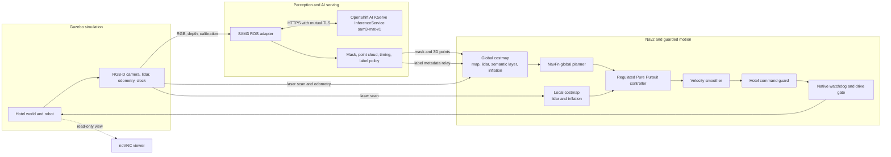

# OpenShift AI Semantic Navigation Demo

This demo shows a simulated hotel robot using SAM3 perception served by OpenShift AI to avoid a red mat while navigating to a goal on the other side. The model identifies the target region; Nav2 turns that result into a cost in its global costmap and plans around it. The model does not choose a route or send movement commands.

## Architecture

The Gazebo fixture supplies the robot’s camera, lidar, odometry and simulation clock. A separate view-only noVNC sidecar displays the scene; it has no robot-control path. The demo waits at a disarmed hold until an operator releases that run’s fresh start token.

## How OpenShift AI serves perception

The SAM3 model runs in the `sam3-mat-v1` KServe `InferenceService` in the `semantic-model-serving` namespace. The ROS adapter sends requests to the cluster’s explicit HTTPS service on port 8443 using mutual TLS. The service uses a custom JSON prediction contract at `/v1/models/sam3-mat-v1:predict`; it is not the KServe V2 tensor protocol.

For each synchronized RGB-D frame admitted to its single-item inference queue, the adapter sends the RGB image with the fixed prompt `red mat`, confidence threshold `0.5`, capture timestamp, frame identity and request correlation fields. If inference falls behind, queued work can be dropped; the system does not send every camera frame. It pins and checks the serving deployment identity before accepting inference, then validates each response against the request and its capture deadline. Requests are single-flight and are not retried.

The response contains a segmentation mask. The adapter pairs that mask with the retained depth frame and camera calibration to publish the mask and an aligned 3D point cloud in the camera frame. It also publishes timing and the fixed label policy `avoid-target/v1`, which maps the target to `avoid_target`. The mask describes image pixels; the costmap layer uses the corresponding depth points and capture-time transforms to place those pixels in the map.

The model server has no ROS graph connection and cannot publish velocity commands. Its responsibility ends at returning a validated perception result.

## How Nav2 uses the AI result

The demo starts Nav2 with the semantic-on configuration. Its global costmap combines the static map, lidar obstacle information, inflation and the semantic layer. The semantic layer subscribes to the mask, points, timing and label metadata. A small relay republishes the latched label metadata between the isolated perception and navigation ROS domains; it forwards the message unchanged.

For the recorded presentation runs, the global semantic layer assigned cost `254` to target cells. The NavFn A* planner treated those cells as lethal and selected a path around the mat. This lethal-cost setting is an experiment used by this demo, not a general production policy. The run’s validation confirmed that the semantic cells were contained within the target region, and that Nav2 produced a plan to the far-side goal.

The rolling local costmap remains geometric: it uses lidar obstacles and inflation, without a semantic layer. This keeps the local controller’s update path separate from the point-cloud workload. Regulated Pure Pursuit follows Nav2’s planned path using the local costmap; the velocity smoother shapes the resulting commands.

Commands then pass through the hotel guard and a native watchdog/drive gate before reaching the simulated robot. The guard checks command provenance and sensor, inference and transform freshness. The model affects where Nav2 plans, but it cannot bypass these checks or directly actuate the robot.

## Demonstrated run and scope

In run 24, the robot started at `(15.402, -31.594)` and navigated to `(19.4008, -31.594)`, the goal on the opposite side of the mat. Nav2 returned `goal_succeeded`. Independent endpoint checking found the simulated robot stopped at `(19.33718, -31.53489)`, about `0.087 m` from the goal, stationary and clear of the far mat edge. The semantic wiring check found 884 cost-254 cells in the global costmap, all inside the audited target rectangle expanded by `0.15 m`, and no semantic layer in the local costmap.

Inference ran live alongside the fixture. Its retained timing log contains 2,011 unique request IDs with completed result timing. The main task-window summary evaluated 1,868 capture-age samples, with 7.01 valid results per second and a 249.7 ms p95 capture-age upper bound; 561 result records were aligned with robot motion. The observer retained 143 further rows during the post-task cleanup tail. These are completed results; the run archive does not provide a separate count of POST attempts that timed out or otherwise failed. See the [run 24 report](validation/semantic-navigation/openshift-ai/S5/navigation-demo-on-24/report.md), [runtime summary](validation/semantic-navigation/openshift-ai/S5/navigation-demo-on-24/trial/runtime/summary.json) and [observer timing log](validation/semantic-navigation/openshift-ai/S5/navigation-demo-on-24/trial/observer-timing.jsonl).

This is a Gazebo simulation demonstration, not a physical-robot trial. A successful run demonstrates this configured route and serving path; it does not establish open-ended object recognition, production suitability of lethal semantic costs, or full G5 acceptance. The current [G5 gate record](validation/semantic-navigation/openshift-ai/S5/gate-result.json) remains HOLD pending the remaining dashboard and independent presenter reviews.

## Key implementation references

- [OpenShift AI SAM3 model server](../apps/semantic-model-server/README.md)
- [ROS SAM3 adapter](../apps/semantic-perception/sam3_ros_node.py)
- [Semantic-on Nav2 configuration](../helm/semantic-navigation/phase6-nav2-candidate-lethal.yaml)
- [Label metadata relay](../apps/semantic-safety/phase6_label_relay.py)
- [Operator demo and view-only noVNC setup](../scripts/semantic-navigation/run_g5_navigation_demo.py)
- [G5 handover and run history](validation/semantic-navigation/openshift-ai/S5/SESSION-HANDOVER.md)
