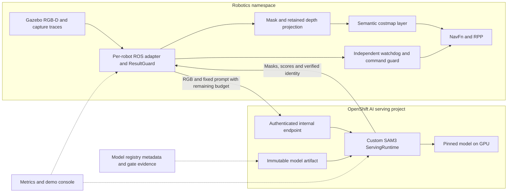

# Semantic navigation with OpenShift AI Model Serving

Date: October 31, 2026. Status updated November 4: G0–G4 are PASS and user-accepted. G4 acceptance rests on all five qualification stages, three complete nominal sweeps, measured exposure reduction, and characterized residuals; the 110-trial series did not complete in one attempt. See the [G4 acceptance record](validation/semantic-navigation/openshift-ai/S4/gate-result.json) and [session handover](validation/semantic-navigation/openshift-ai/S4/SESSION-HANDOVER.md). G5 has verified registry registration, three stopped replay update/rollback cycles, credential rotation, authenticated serving monitoring, dependency isolation, actual pod-loss/wrong-version safety and live navigation telemetry; it remains HOLD pending dashboard/evidence-link visual review and the complete new-presenter demonstration. See the [G5 report](validation/semantic-navigation/openshift-ai/S5/report.md). G6 remains pending. This replaces the October 13 migration outline.

## Recommendation and customer outcome

Serve the existing, pinned SAM3 image-segmentation model through **OpenShift AI single-model serving with a custom KServe runtime**, initially using RawDeployment mode and one warm GPU replica. Replace the in-process inference call with a bounded HTTP client while preserving the ROS sensor adapter, capture-time geometry, semantic costmap plugin, NavFn/RPP, and independent stop mechanisms.

“Local inference” here means inference inside the customer's OpenShift cluster. The existing implementation already runs SAM3 in a cluster GPU pod; the enhancement is OpenShift AI management of the model as an independently deployable, observable service that multiple robot adapters can consume. It does not move cloud inference on premises for the first time. An on-premises customer deployment can retain camera data locally; a cloud-hosted cluster remains cloud-hosted.

The customer demonstration should establish three distinct outcomes:

1. **Navigation value:** a robot avoids a visually recognized mat that geometric navigation crosses, using a model served by OpenShift AI.
2. **Operational value:** operators see model identity, serving health, inference latency, navigation freshness, controlled upgrades, and rollback in one demonstrable workflow.
3. **Fleet value:** multiple robot streams consume centrally managed model capacity with isolation and measured per-robot service levels. This claim requires the fleet gate; a single-robot run cannot establish it.

Workbenches, training pipelines, model fine-tuning, LLM reasoning, dynamic prompts, tracking, multi-floor navigation, and RMF mission changes are outside the first serving integration. The pretrained image model is sufficient to demonstrate serving; any future learning pipeline has separate recognition gates.

## Accepted baseline and implementation gaps

The authoritative baseline is the [October 30 Phase 6 sign-off](validation/semantic-navigation/phase-6/sign-off-review-20261030.md) and [acceptance record](validation/semantic-navigation/phase-6/phase6-acceptance.json), rather than the older status paragraph in the [implementation plan](semantic-navigation-implementation-plan.md).

| Baseline evidence | Design consequence |
| --- | --- |
| Series 23: 20 nominal trials per arm plus 18 negative trials; all 58 passed; zero collisions | Reuse the paired experiment and its evaluator for the served backend |
| On-arm hull exposure 0.000 m versus off-arm 28.084 m, a 100% reduction | Preserve the ≥90% reduction gate and a nonzero off-arm baseline |
| Accepted exclusion experiment used cost 254; soft cost 200 remains the production candidate | Show the accepted exclusion experiment explicitly; do not claim identical avoidance from soft cost 200 without separate trials |
| Phase 2 recognition review and held-out scoring remain waived | Serving parity does not establish recognition accuracy; retain the demo limitation or close the original recognition gate separately |
| Belief/truth endpoint divergence, AMCL ambiguity, capture-trace race and private-fixture deviations accepted | Preserve divergence reports, capture-time TF witness, guarded rendering profile, and the restricted infrastructure retry rules |
| Phase 3 ten-minute run: 6.82 valid pairs/s, 100% pairing, p95 through observer validation 243.93 ms | Added serialization, networking, authentication and queueing have very little timing headroom |

The [Phase 3 report](validation/semantic-navigation/phase-3/runtime-report.md) pins SAM3 source commit `0570b3a5be9c4e694f23d85232fb55f4a6f1f7fc`, checkpoint revision `3c879f39826c281e95690f02c7821c4de09afae7`, and checkpoint SHA-256 `9999e2341ceef5e136daa386eecb55cb414446a00ac2b55eb2dfd2f7c3cf8c9e`. Freeze the actual Phase 6 runtime image and configuration from its accepted deployment inventory at S0; do not substitute a historical Phase 3 image for later overlays.

Existing reusable code:

- [sam3_backend.py](../apps/semantic-perception/sam3_backend.py): ROS-independent `Sam3ModelRunner` and `LocalSam3Backend.predict(request)`. It requires CUDA, selects BF16 when supported (otherwise FP16), and processes independent images. No tracking session needs migration.
- [inference_contract.py](../apps/semantic-perception/inference_contract.py): `semantic-inference/v1`, bounded serialization, request identity, capture metadata, typed failures, and `ResultGuard`.
- [sam3_ros_node.py](../apps/semantic-perception/sam3_ros_node.py): RGB-D synchronization, capture freshness, bounded work, retained cloud, result validation and ROS outputs. It now selects the local GPU runner or the bounded mTLS HTTP backend explicitly; G2 qualified the CPU adapter on isolated diagnostic topics.
- Existing [phase 3 verification scripts](../scripts/semantic-navigation/verify_phase3_backend.py), [phase 5 fault harness](../scripts/semantic-navigation/run_phase5_semantic_fault_matrix.py), and [phase 6 series runner](../scripts/semantic-navigation/run_phase6_series.py) provide the regression foundation.

The contract's `versions.model` is a revision string, not proof of loaded weights. `response_base()` uses compile-time version constants. Serving must add independently verified artifact identity rather than merely echoing requested metadata. The request factory defaults to `robot_1`; the ROS node now passes explicit configurable robot and stream IDs. Fleet qualification remains G6.

## Serving architecture and platform choice

Red Hat documents KServe model deployments and RawDeployment as an option for custom serving setups and models that must stay active. Custom runtimes provide the integration path for specialized model code; this is an architectural choice, not a claim that SAM3 is a built-in supported runtime. The custom server remains our maintenance responsibility. [Deployment modes](https://docs.redhat.com/en/documentation/red_hat_openshift_ai_self-managed/3.5/html/deploying_models/deploying_models), [custom runtime support](https://docs.redhat.com/en/documentation/red_hat_openshift_ai_self-managed/3.4/html/managing_and_monitoring_models/managing-and-monitoring-models_cluster-admin).

Read-only cluster inspection on October 30 found OpenShift 4.21.16, the OpenShift AI operator CSV `rhods-operator.3.4.1`, and ready KServe, model-registry operator and dashboard deployments. Twelve nodes advertise one allocatable NVIDIA GPU each; allocatable capacity is not free capacity. Use the installed 3.4.1 release's supported configuration and CRD schema. The 3.5 references below explain general platform concepts, not availability of newer features on this cluster. Exact KServe operand version, available GPU allocations, enabled serving mode and storage compatibility remain S0 prerequisites. Consult the [Red Hat compatibility matrix](https://access.redhat.com/articles/rhoai-supported-configs) before selecting the release.

**S0 completion update:** OpenShift AI `rhods-operator.3.4.2` and COO `cluster-observability-operator.v1.5.3` report `Succeeded`; Perses conversion and dashboard reconciliation are restored. MaaS retains its 1 GiB memory limit. Overall `Ready`, `DashboardReady`, `ModelsAsServiceReady` and `KserveReady` remain True. G0 technical verification now passes: the reproduced baseline pair reduced hull exposure from 1.409 m off to 0.000 m on with no collisions; the dedicated project has a verified checkpoint copy, TLS/client credentials, policy, quota and image-pull permissions; separate serving and rendering GPUs are reserved; final resources pass destination server-side dry-run. The original local SAM3 pod is restored and emitting valid results. See the [G0 completion record](validation/semantic-navigation/openshift-ai/S0/g0-completion-20261030/report.md). The user approved G0 on October 31, 2026. Certificates expire November 7, 2026 at 02:58:59 UTC; revalidate credentials and reservations before G1.

The adapter remains a robotics workload, initially with the existing sensor transport placement. Only model execution moves behind the service boundary. Depth clouds, TF lookup, cost assignment, and motion authority remain outside the server. The model server has no ROS/Zenoh participation and no command credentials.

| Proposed resource | Responsibility |
| --- | --- |
| Dedicated OpenShift AI project, for example `semantic-model-serving` | Separate service identity, quotas, model connections and access policies |
| Namespaced `ServingRuntime` for SAM3 | Digest-pinned CUDA/PyTorch container, runtime protocol, model mount and probes |
| Version-specific `InferenceService`, such as `sam3-mat-v1` | Explicit runtime selection, fixed model identity, one warm replica initially |
| Internal TLS endpoint with authenticated service access | Stable model-version URL reachable by authorized robotics adapters; no public inference route required |
| Immutable artifact in controlled object storage or a serving-project PVC | Weights plus manifest; validate checksum before readiness; avoid request-time downloads |
| Per-robot CPU adapter deployment | No GPU or weights required in served mode; retains local backend as an explicit rollback configuration |
| Metrics collector and console integration | Serving metrics, per-robot freshness, model identity and gate results |

Begin with the same accelerator class and precision as the accepted runtime. Inventory actual resource assignments: Phase 6 moving validation requires GPU-rendered Gazebo, so the inference GPU cannot simply be taken away from the accepted fixture. Reserve rendering and serving capacity explicitly. If only one GPU is available, co-location/sharing is a new measured configuration; it is not assumed to preserve timing. A PVC in the robotics namespace cannot be mounted across namespaces; copy verified weights into the serving project or use an authorized object-store connection.

Use fixed replica counts for initial qualification, with no scale-to-zero. Readiness requires checksum validation, loaded weights, and successful warm-up. Liveness should detect a stuck worker without making an inference request on every probe. One serial model worker per GPU avoids unqualified concurrent use of `Sam3Processor`; HTTP concurrency does not imply safe GPU execution concurrency. Inference process hang detection and recycling are separate from the robot watchdog.

A custom KServe predictor wrapper should expose `/v1/models/<model-name>:predict`, accepting the existing semantic request as its documented application body, plus health and model-metadata endpoints. This is a custom JSON contract, not a claim of V2 tensor-protocol conformance. Verify routing, body limits and dashboard registration on the installed release at S1. Keep the wrapper thin; an ONNX/OpenVINO export or Triton conversion would change more variables and belongs to a later optimization experiment. Upstream SAM3 provides image-prompt inference APIs that match the current runner. [SAM3 source and examples](https://github.com/facebookresearch/sam3).

**S1 qualification update:** G1 technical checks passed on October 31. Three frozen cases produced nine exact parity comparisons across three replay batches; all three cold starts, 22 live contract/security checks, network isolation and whole-process hang recovery passed. The authenticated AI dashboard API and installed frontend selection rules confirm registration after correcting the runtime dashboard label. The endpoint remains isolated from ROS and motion. See the [G1 evidence and limitations](validation/semantic-navigation/openshift-ai/S1/g1-qualification-20261031/report.md).

## Inference contract and navigation behavior

Retain the current lossless RGB8/base64 input and uint8 instance-mask response for the first comparison. At 640×480, RGB alone is 1,228,800 base64 bytes per request; one full mask is 409,600 bytes. At five requests/s, those payloads total about 8.2 MB/s per robot before headers and additional instances. The current 64-instance cap permits about 26.2 MB of base64 masks, within the 28 MiB wire cap. Test these bounds at both proxy and application layers. A low instance count in the mat scene must not hide worst-case memory use.

The adapter must:

1. Select the newest synchronized RGB/depth/CameraInfo bundle using the existing bounded queues and capture trace. Retain original timestamps and depth locally.
2. Register the request with `ResultGuard` before transport. Send robot, stream, sequence, epoch, generation, request ID, capture header, fixed prompt/threshold and remaining time budget. Keep at most one in-flight request and one replaceable waiting bundle per robot.
3. Use connection reuse and an absolute client-side deadline covering encode, connect, upload, response read and decode. A socket inactivity timeout alone is insufficient. Do not transmit absolute monotonic timestamps between hosts.
4. Validate response size, schema, dimensions, identity, version, mask encoding, scores and retained-cloud lifetime before publishing unchanged `/robot_1/semantic/*` interfaces. Expired, duplicate, reordered and pre-reset results are discarded.
5. Treat a valid empty mask as a fresh observation. Treat timeout, authentication failure, network failure, overload, wrong model, malformed output and a hung process as failures, never as empty segmentation or fresh heartbeat.

Keep the server model identity derived from its loaded manifest: weight SHA-256, source revision, container digest, preprocessing/decoder versions and selected precision. Advertise it through metadata and return an additive deployment identity field checked by the remote client. Formalize this additive contract extension and its conformance tests before deployment; do not silently change the meaning of existing v1 fields. The adapter pins the identity for the entire navigation run. Unknown or inconsistent identity prevents arming.

The server validates input before model execution and bounds admission and queued work. Start with immediate overload rejection when its single worker cannot meet the request budget; add a short, measured fair queue only for S6. Record queue delay separately. Validate malformed envelopes without calling `response_base()` on missing identity fields, since the current local helper assumes a well-formed request. Enforce the qualified prompt/threshold policy server-side as well as client-side.

Client timeout does not cancel an already running CUDA kernel. Discard late results, prevent unbounded queued work, and recycle a hung worker through a bounded recovery path. Never retry an obsolete image. Health polling may retry independently; model inference failure must not block the existing watchdog thread or command guard.

Preserve the 500 ms capture-freshness trigger and zero command within 100 ms of that trigger, plus all existing geometry, TF and command freshness checks. Clearing stale semantic observations must not authorize continued motion. Recovery requires stopped motion, invalidated pending requests and epochs, verified buffer/map clearing, fresh valid results, and explicit operator resume. Never switch models, backends or geometry-only mode silently during a semantic task.

Lossless compression or packed/RLE masks are possible optimizations if the first timing gate fails. Version and test any encoding change for exact decoded equivalence. Do not introduce lossy JPEG, different resolution, quantization, or relaxed freshness thresholds as an implicit networking fix.

## Operations and customer presentation

Use service accounts with least privilege, short-lived credentials and verified TLS. Select the installed release's supported authorization mechanism at S0 and test the actual internal endpoint: external-route authentication must not be assumed to protect a direct ClusterIP path. NetworkPolicies restrict robotics-to-serving access and serving egress; allow required DNS, artifact retrieval, monitoring and authorization dependencies. Keep credentials and raw images out of normal logs. Persist only explicitly selected evaluation images in the evidence store.

Bind each authenticated client's allowed robot/stream identities to an explicit policy; request fields alone are not authorization. Include spoofed robot identity in the fleet isolation tests. A CPU adapter may share a pod with existing components initially, but its served backend must not initialize CUDA or load model weights.

Register the checkpoint, runtime manifest, prompt policy, evaluation status and evidence URI in the OpenShift AI model registry for lifecycle demonstration. The registry stores metadata; weights remain in artifact storage. A registry entry or promotion label does not itself qualify a model. [Model registry role](https://docs.redhat.com/en/documentation/red_hat_openshift_ai_self-managed/3.5/html/managing_model_registries/overview-of-model-registries_managing-model-registries).

Expose request rate, success/error counts, queue time, inference duration, worker health, GPU utilization/memory and model identity. Instrument the adapter for capture-to-result and capture-to-costmap age, drops, last valid capture, watchdog state and stop reason. Server latency alone cannot establish navigation latency. Keep request IDs in bounded traces rather than high-cardinality metric labels. Show simulation real-time factor alongside wall-clock capture age.

The presenter should be able to demonstrate:

1. OpenShift AI's model deployment, GPU allocation and pinned model version.
2. Mat overlay and semantic-off/on paths side by side, with identical scene, planner and controller settings.
3. Live capture age, served inference latency and semantic costmap updates linked to the same request stream.
4. An induced serving outage: explicit failure, bounded stop, no automatic resume, then operator-controlled recovery.
5. A validated model/runtime update and rollback between stopped runs, with identity and evidence visible.
6. After S6, two independently identified robot clients and their individual timing/fault results. Replayed streams are labeled as load tests, not an RMF fleet demonstration.

Use version-specific endpoints for promotion. Validate a candidate in replay/shadow mode, stop the task, clear pending state, select the candidate endpoint, obtain fresh results and re-arm. Do not randomly split an active robot's requests across model versions. With one GPU, use a planned stopped recreate/rollback demonstration; do not promise simultaneous blue/green availability without spare capacity. Loss of registry or dashboard access should not interrupt an already loaded model's data path; demonstrate that independence.

## Phased implementation and verifiable gates

S0–S4 deliver the single-robot served-navigation demonstration. S5 completes the operations story. S6 is required before claiming verified multi-robot serving. Preserve separate S-numbering to avoid reopening accepted navigation Phases 0–6.

Every gate reports `PASS`, `FAIL` or `HOLD`, with exact commands, manifests, image/model hashes, configuration, timestamps, resource limits, raw results and evaluator output. Thresholds and evaluation sets are frozen before the run. Retain failed attempts; infrastructure retries follow a declared policy and never erase check failures. Numerical additions below are proposed acceptance criteria, not measured results.

| Phase | Deliverables and verification | Exit gate |
| --- | --- | --- |
| **S0 — Freeze baseline and provision plan** | Platform owner inventories OCP/AI/KServe versions, CRDs, permissions, GPUs, rendering placement, driver/CUDA compatibility, storage, internal TLS/auth, quotas and artifact availability. Robotics owner freezes accepted Phase 6 identities and reproduces one baseline off/on pair. Render and server-dry-run proposed resources. | **G0:** compatibility and capacity documented; resources validate; baseline pair reproduces expected route/exposure behavior; checkpoint and rollback artifacts accessible. HOLD on unresolved operator, GPU, storage or endpoint security prerequisites. |
| **S1 — Package the model server** | Model owner builds the custom runtime, verifies weights, deploys an isolated warm endpoint and replays a frozen set containing mat, absent-target and empty-mask cases. Run existing contract tests plus malformed/oversized input, wrong identity, readiness, auth and restart tests. | **G1:** correct runtime appears in OpenShift AI; three cold-start cycles reach readiness only after warm-up; no inference egress; all contract/security checks pass. On identical hardware/precision, proposed per-frame union-mask IoU ≥0.99, empty/nonempty agreement 100%, and occupied-pixel fraction difference ≤0.5 percentage points against local output. Investigate every mismatch; freeze any justified tolerance change before a new run. This is backend parity only, not closure of the recognition waiver. |
| **S2 — Integrate the CPU ROS adapter** | Robotics owner adds backend selection, bounded HTTP transport, explicit robot/stream IDs and loaded-identity validation. Run served output in isolated diagnostic topics without costmap influence. Replay resets, late/duplicate/reordered replies, lost retained depth, network loss, 401/403, overload, wrong model and process hang. | **G2:** all contract/reset/failure tests pass; remote mode starts without weights or a GPU; one in-flight request and bounded buffers verified; no stale or mismatched publication; no readiness from model health alone. |
| **S3 — Qualify live timing and projection** | Run the existing capture-origin observers and costmap evidence collectors, stationary and moving-observation fixtures with semantic navigation influence disabled. Use intended CPU/GPU quotas, TLS/auth and representative background load. Perform three independent ten-minute runs. | **G3:** each run ≥5 fresh valid results/s, p95 capture-to-result ≤250 ms, ≥95% mask/depth pairing with zero wrong-pair acceptance, p95 capture-to-costmap ≤300 ms, and no unexplained >500 ms healthy-run publication gaps. Preserve projection/clearing tests, bounded memory and capture registration. Record tails and drops, not just averages. |
| **S4 — Requalify served navigation** | Repeat Phase 5 moving observation, recovery and stop gates with the server in the path, then the accepted Phase 6 paired series. Add serving/network/auth/overload/hang/wrong-version faults during motion. | **G4:** original Phase 5 gates pass, including the 500 ms freshness trigger and zero command within 100 ms; at least two repeats of each added fault class pass with no automatic motion resume. Complete 20 nominal pairs plus three pairs each for target absent, target removal and perception failure: ≥90% exposure reduction, nonzero baseline exposure, completion and zero-collision criteria pass. Preserve lethal-254 framing and belief/truth reporting. |
| **S5 — Demonstrate lifecycle and operations** | Platform/model owners add registry metadata, dashboards, operator runbook, credential rotation, planned update, rollback, pod-loss recovery and external inference-egress denial tests. A new presenter performs the script. | **G5:** three update/rollback cycles return to the pinned identity with no mixed-version accepted results or automatic resume; unauthorized clients rejected; rotation succeeds; loaded serving continues without registry/dashboard availability; required metrics and evidence links visible. Warm rollout, if claimed, must be measured with spare capacity; otherwise show a declared stopped maintenance window. |
| **S6 — Qualify fleet serving** | Add robot_2 with separate stream/epoch/policy state. Start with concurrent replay, then two isolated navigation clients if showing fleet motion. Sweep one, two and higher stream counts, include noisy-neighbor overload and one-client reset. Add replicas only with measured GPU capacity and bounded fair admission. | **G6:** at the declared supported fleet size (minimum two), each robot independently passes G3 in three ten-minute runs; zero cross-robot result acceptance, starvation or state leakage; both robots pass the applicable motion/fault checks for a moving-fleet claim. Above capacity, explicit overload and bounded stops occur. Publish maximum qualified concurrency and GPU/resource cost; aggregate FPS is insufficient. |

S1 parity can progress with the standing demo recognition waiver explicitly recorded. Any claim of general floor-surface recognition requires the deferred held-out labels and original recall/IoU/false-positive gates from the main plan. All downstream gates HOLD after an upstream failure until the changed configuration is revalidated; no threshold relaxation merely to make remote serving pass.

At S3, investigate encode/decode cost, proxy overhead, CPU contention, network transfer, queueing and GPU execution separately if timing fails. The 243.93 ms historical p95 leaves approximately 6 ms to the 250 ms target, but subtracting historical percentiles is not a reliable latency budget. Use correlated end-to-end traces on the new topology. If required rates cannot be met, report the service as suitable for offline/shadow use until an optimization passes the same gates.

For fleet sizing, use measured service time rather than multiplying single-robot FPS. As a planning estimate, a serial worker serving N robots at 5 requests/s each has utilization approximately `N × 5 × mean_service_seconds`; target headroom (initially ≤70% for planning) and then qualify actual per-robot tail latency. The existing 6.82/s pipeline result does not establish two-robot capacity. Multi-replica load balancing is safe only for the stateless, same-version model and still requires bounded admission and sufficient GPUs.

## Repository implementation map and evidence

| Location | Proposed changes |
| --- | --- |
| `apps/semantic-perception/` | Backend factory, HTTP backend, transport tests, explicit robot/stream parameters, verified artifact identity; preserve local runner and guard |
| New `apps/semantic-model-server/` | Thin predictor wrapper reusing shared runner/contract, model manifest, probes, bounded worker, metrics and container build |
| New `helm/semantic-navigation/openshift-ai/` | Version-qualified runtime/InferenceService, artifact connection references, policies, service identity, monitors and isolated adapter overlays |
| `scripts/semantic-navigation/` | Serving preflight/replay/load/fault scripts; extend existing observers and phase 5/6 launchers with explicit backend/endpoint identity |
| Existing demo console | Backend/model identity, serving health, capture age, stop reason and evidence links; dashboard availability never controls motion |
| `docs/validation/semantic-navigation/openshift-ai/S0/` through `S6/` | Per-gate manifests, sanitized inventory, reports, hashes, raw metrics and acceptance records; large captures referenced by checksum |

Avoid divergent copies of `sam3_backend.py` and `inference_contract.py`: package or build both images from the same shared source revision. Proposed scripts and resource paths above are deliverables, not existing runnable commands.

Each `gate-result.json` should include gate, status, commit, runtime/model hashes, policy and precision, cluster versions, hardware/resource profile, evaluation-set hash, sample count/duration, measured percentiles/rates, fault outcomes, deviations/waivers and evidence paths. Acceptance records should identify the reviewer and exact configuration accepted. Preserve the earlier implementation plan's review convention; document approval does not mark deployment gates passed.

The first implementation milestone is G0, followed by a served replay endpoint at G1. The first customer-ready navigation milestone is G4; the complete OpenShift AI lifecycle demonstration requires G5, and the fleet-serving claim requires G6.
