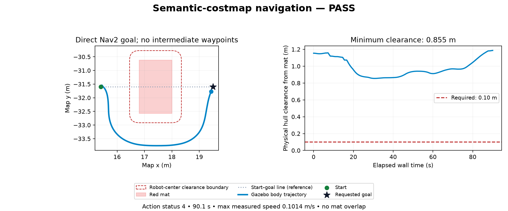

# Phase 6 semantic-cost navigation readiness

Investigation: 2026-11-10 through 2026-11-11 (UTC)

## Current result — PASS

The complete semantic-on Nav2 demo passed from the original staged start to `(19.5, -31.594)`, with no intermediate waypoints. The action returned **SUCCEEDED (4)** after **90.052 s**. Physical circular-hull clearance from the mat stayed at least **0.8549 m**; every monitored map-frame global plan maintained at least **0.6155 m**. The required clearance remains 0.10 m. There was no mat overlap, Collision Monitor intervention, stale-pose/pose-alignment failure, or speed breach. Maximum measured speed was 0.1014 m/s, within the 0.10 m/s cap plus the existing 0.005 m/s measurement tolerance.

The global semantic layer was confirmed enabled at cost 254. Observed cells remained between 917 and 1106 across 77 updates, including views that projected zero new mat cells. The robot is stopped at approximately `(19.4363, -31.7719)`; independent Gazebo truth measured residual speed 0.0000012 m/s. This is a **Phase 6 fixed-mat demo pass**, not production qualification or a new OpenRMF integration test.

Evidence: [trial summary](static-memory-full-route-20261111-summary.json), [full trajectory and paths](static-memory-full-route-20261111.json), [trajectory plot](static-memory-full-route-20261111.png), [stopped pose](static-memory-full-route-stopped.yaml), [Nav2 log](static-memory-full-route-nav2.log), and [deployed pods](static-memory-runtime-pods.json). Validation: **31 C++ tests and 45 Python demo tests passed**.

The sections below preserve the investigation history; their earlier failure statuses are superseded by the result above.

## Initial stationary preflight (historical)

The Phase 6D D2 semantic-on direct-goal planner preflight passed with no waypoint (`via_map` empty). The Nav2 global semantic layer was enabled and confirmed, and the raw costmap update reported 917 cost-254 semantic cells. Nav2 planned to `(19.5, -31.594)` without a centerline intersection with the staged mat. The plan's minimum measured circular-hull clearance was 0.2062 m against the required 0.10 m. This initial check dispatched no navigation goal.

## Live navigation result

After the user checked noVNC and gave `go`, one semantic-on direct-goal run started under a 0.10 m/s cap. The semantic layer remained enabled; the runner observed 533 global cost-254 cells and the direct Nav2 plan again avoided the mat. The live trajectory monitor measured only 0.0946 m hull clearance, below the 0.10 m requirement, and canceled the goal after 18.2 seconds. The robot stopped at approximately `(16.4665, -31.4853)` with near-zero velocity. There was no mat-hull overlap, speed-cap breach, Collision Monitor event, stale-pose breach, or odometry/truth disagreement.

The run demonstrates that semantic costs were active and influenced the planned route, but the executed motion did not maintain the planner's predicted clearance margin. The demo is **not ready for sign-off**. No second goal has been sent. Static review found that semantic projection varied substantially as the camera viewpoint changed (917 lethal cells at preflight, then 533 during the run, later 475). This is a likely contributor to the planner/execution mismatch, but the exact causal chain is not yet confirmed.

The isolated simulator and Nav2 pods were recreated to restore the staged start for a requested rerun. The new no-motion preflight passes with 957 global cost-254 cells, no waypoint, zero mat-intersection samples, and 0.1963 m planned hull clearance. No goal has been dispatched after reset. The new noVNC view must be checked before motion.

The original preflight had a false rejection: its clearance gate expanded the mat AABB by the hull radius, producing square corners, while reporting 0.2062 m clearance. The route rounded past one expanded-box corner without entering the true circular-hull clearance envelope. `demo_target_geometry.py` now checks the exact segment-to-rectangle distance against hull radius plus required margin. This preserves the clearance threshold while removing the corner false positive.

## Rerun after reset

After the user checked noVNC and gave `go`, the direct-goal semantic-on run was repeated from the staged start with the same 0.10 m/s cap and full trajectory recording. The Nav2 global semantic layer was confirmed enabled and the runner observed 520 cost-254 cells. The preflight plan had 0.2062 m hull clearance and did not cross the mat centerline. During motion, the live monitor canceled at 0.0998 m clearance after 18.1 seconds, at `(16.4556, -31.4889)`. There was no speed-cap breach, measured mat overlap, pose-liveness breach, or Collision Monitor event. The robot is stopped; no subsequent goal was sent. Full evidence is in [`semantic-on-live-run-rerun.json`](semantic-on-live-run-rerun.json).

The repeated failure confirms the clearance issue is not fixed. Semantic-cell counts changed from 957 at the fresh no-motion preflight to 520 during the live run, and later 475 in costmap logs. This changing projection is a plausible source of the planner/execution mismatch, but is not yet proven to be the only cause. The run is not a pass.

## Root cause and fix candidate

The retained live run shows that the semantic observation was not spatially stable as the robot-mounted camera viewpoint changed. The global layer reported 957 cost-254 cells during the fresh preflight, 520 during navigation, and later 475. The configured cell lifetime was 1 s. The runner checked one preflight path before dispatch and only monitored actual robot clearance during motion; it did not reject a later global replan that came too close. This combination allowed Nav2 to replan from a reduced semantic footprint.

The D2 semantic-on candidate now retains projected global cells for 5 s, increases global inflation radius from 0.60 m to 1.0 m, requires at least 0.20 m planned hull clearance before dispatch, and monitors map-frame `/plan` updates during motion. If a live global plan enters the existing 0.10 m physical clearance envelope, the runner cancels the goal. The controller-path evidence now records its frame explicitly; prior live path coordinates were recorded without their frame.

After applying this candidate and restoring the staged start, the no-motion preflight passed: 917 global cost-254 cells, map-frame direct plan, no mat intersection, and 0.6764 m minimum hull clearance. `motion_dispatched` was false. This validates the candidate profile and preflight gate only; the updated live monitoring and motion behavior still need a user-reviewed run.

## AMCL readiness gap and fix

The next approved motion attempt did not produce a runner result file. Nav2 logs show repeated `AMCL cannot publish a pose ... Please set the initial pose` warnings, followed by a controller progress-check failure and recovery retries. The run profile explicitly has `amcl.set_initial_pose: false`, while the D2 runner checked wheel odometry against simulator truth but never published `/initialpose` or required a fresh `/amcl_pose` before sending the navigation goal. Thus the semantic layer was populated, but Nav2 localization was not initialized for the staged simulator reset. The robot remained at the staged position. A cancel-all request returned no goals, and an independent truth sample reported zero linear and angular velocity.

The D2 runner now seeds AMCL from the fresh, stationary Gazebo pose, waits for a new map-frame AMCL pose, and blocks planning or motion unless AMCL agrees with Gazebo within 0.25 m and 0.20 rad. The runner also uses simulated ROS time for navigation messages. This fixes a separate readiness gap that the semantic-cell and path-clearance checks could not detect.

With the updated runner deployed, a no-motion preflight succeeded: AMCL/Gazebo error was 0.0283 m and 0.0109 rad, the global costmap contained 917 cost-254 cells, and the map-frame path maintained 0.6764 m hull clearance. `motion_dispatched` was false, and the post-preflight truth sample was still at `(15.4014, -31.594)` with zero velocity. Evidence: [`amcl-seeded-no-motion-preflight.json`](amcl-seeded-no-motion-preflight.json) and [`amcl-uninitialized-run-nav2.log`](amcl-uninitialized-run-nav2.log).

## AMCL-seeded live rerun

The user approved a live rerun after noVNC review. AMCL initialization now passed: its dispatch pose was within 0.0036 m and 0.0039 rad of Gazebo. The semantic layer remained stable at 917 cost-254 cells across 152 updates. Both preflight and live global plans were in `map` and kept 0.6764 m hull clearance. No clearance breach, mat overlap, speed-cap breach, or Collision Monitor event occurred.

The runner canceled the action after 180 s without moving the robot: Nav2 `/cmd_vel` reached 0.06 m/s, but odometry and independent Gazebo truth both remained at zero, with all 3,134 truth samples at the staged position. A separate zero-Twist probe was published on Nav2 `/cmd_vel` but was not observed on the simulator ROS topic or Gazebo Transport topic, despite the Zenoh publisher/subscriber routes being announced. The current failure is therefore in Twist delivery to the simulator (or its actuation input), not semantic planning. The exact point of loss still needs isolation. Evidence: [`semantic-cost-nav-amcl-fix-live-summary.json`](semantic-cost-nav-amcl-fix-live-summary.json), [`cmd-transport-probe.md`](cmd-transport-probe.md), and the full [`semantic-cost-nav-amcl-fix-live-20261110.json`](semantic-cost-nav-amcl-fix-live-20261110.json).

## Command transport recovery and synchronized motion (2026-11-11)

A new overlapping zero-command probe confirmed missing delivery. Restarting only the motion-output bridge, with Nav2's publisher already active, restored the DDS reader on `/cmd_vel` (subscription count changed from zero to one). The simulator then received zero commands. The same pinned bridge image was used; its pod image reference gained `:latest` before the unchanged digest solely to trigger the container restart. Missing AMCL initialization was a readiness gap, but it was not the established cause of the missing actuation. This demo uses the fixed odometry transform with AMCL TF broadcasting disabled.

The first motion attempt after transport recovery was canceled after 2.872 s by the pose comparison. The runner repeatedly recalculated the same global plan on every callback, delaying queued truth samples relative to odometry. Once stationary, the poses agreed. The runner now processes each new plan once, keeps only the newest odometry/truth sample, and compares poses only when their source timestamps differ by at most 50 ms. Failure to obtain aligned samples for 0.5 s still cancels motion. A new dispatch gate requires a bridge DDS reader, excluding the runner's own subscriber. Twenty-four D2 unit tests pass, including timestamp and missing-reader regressions.

The subsequent synchronized trial moved from `(15.5663, -31.6124)` and was canceled after 11.322 s by the live global-plan monitor. Semantic cells varied from 1005 to 802; the live plan's minimum hull clearance became **-0.0461 m**, while actual robot clearance remained **0.4635 m**. Maximum measured body speed was 0.0894 m/s, with no overlap, collision-monitor intervention, or pose-alignment failure (maximum position/yaw disagreement 0.0134 m / 0.0154 rad). This confirms that the 5 s retention and 1.0 m inflation candidate still permits an unsafe semantic replan; the monitor stopped execution before the robot reached the mat. ROS action status 5 means **canceled**, not aborted.

Evidence: [transport-restored trial](semantic-transport-restored-20261111-summary.json), [synchronized trial](semantic-synchronized-20261111-summary.json), and the adjacent full trajectory JSON files. The robot is stopped. No sign-off is claimed.

## Static-mat memory correction (2026-11-11)

The global layer now supports an opt-in `static_obstacle_memory` duration, capped at 300 seconds and rejected for rolling costmaps. D2 enables 300 seconds for its fixed red mat. Only validated, capture-time transformed semantic observations populate the memory; the mat geometry used by the trial monitor is not injected into the costmap. The default remains zero, preserving the existing observation TTL for other profiles. Capture-age admission, layer currentness, capacity limits, and policy/stream/lifecycle/clock-reset clearing are unchanged. An empty or partial subsequent view therefore does not erase the known fixed obstacle during the maneuver.

Regression tests cover camera turn-away, stale-input rejection/currentness, independent wall/simulation expiry, policy/reset/clock clearing, and rejection of rolling-map or unbounded memory configurations. The Phase 6 image build now runs the C++ test suite before publishing. The live runner also verifies the deployed memory parameter before dispatch. Build 8 passed 31 C++ tests and published `semantic-nav2@sha256:5a951c79f08804ec7c19512feb0de77e9b9a015463da09d2c4f05bf97e983935`. The D2 renderer pins that image.

The pinned Phase 6 SAM3 runtime predates the plugin's epoch-bound policy schema. `phase6_sam3_policy.py` wraps that same runtime and publishes its own actual epoch/generation/prompt every second. It preserves inference, masks, clouds, and capture timestamps. This supplies the required stream identity and eliminates reliance on one-time latched policy delivery. D2 rendering includes this wrapper and its inference pod; other profiles retain their original runtime. The Python demo suite passes 45 tests, including producer epoch changes.

## Goal-heading correction and full-route retest

The first memory-enabled run avoided the mat throughout: physical hull clearance stayed at least 0.6270 m and all global plans stayed at least 0.6054 m away. Semantic cells grew from 917 to 1200 instead of disappearing. However, with `FollowPath.use_rotate_to_heading=false`, the robot drove past the goal and circled while trying to meet the requested yaw. The run was manually canceled after 127.952 s; no clearance or speed gate triggered. See `static-memory-live-20261111-summary.json` and the full trajectory.

D2 now enables `FollowPath.use_rotate_to_heading` and `FollowPath.stateful`. The isolated heading-completion check then succeeded (action status 4) in 7.701 s. A full-route retest uses a fresh simulator/Nav2 reset, the original start, and no intermediate waypoints.

After this reset, the simulator published `/clock` locally but its Zenoh bridge did not forward it. Restarting only `sim-zenoh-bridge` after the ROS publishers were live restored clock, odometry, camera traffic, and semantic observations. Nav2 activated without a container restart. A zero-Twist end-to-end probe confirmed delivery before motion. This startup recovery remains an operational step for this demo's pinned bridge; the runner must not dispatch until real inputs, semantic cells, and the motion DDS reader are present.

## User-approved repeat (2026-11-11 02:20 UTC)

After the user's next `go`, the simulator and Nav2 were reset to the original start. This time the simulator's local clock was confirmed before creating Nav2; all inputs and the zero-command delivery probe passed without bridge restarts. The same semantic-on, direct-goal run succeeded in **77.801 s**, with **0.8133 m** minimum physical hull clearance and **0.6255 m** minimum monitored global-plan clearance. Semantic cells stayed between 962 and 1045. Maximum measured speed was 0.1010 m/s, within the existing tolerance. No mat overlap, collision intervention, speed breach, or pose-monitor failure occurred. The robot stopped at approximately `(19.4377, -31.4128)`.

Evidence: [repeat summary](semantic-go-repeat-20261111T0220-summary.json), [full trajectory](semantic-go-repeat-20261111T0220.json), and [stopped pose](semantic-go-repeat-20261111T0220-stopped.yaml).

## Sign-off status

**Ready for review/sign-off of the fixed-mat Phase 6 semantic navigation demo.** The full route passed with semantic costs enabled, no waypoints, successful final-heading completion, and all existing motion/clearance gates satisfied. Root fixes are bounded static-obstacle memory, epoch-compatible recurring producer metadata, and restored in-place goal rotation. The default semantic TTL remains unchanged for other profiles.

The pinned Zenoh bridge can still need a restart after simulator publishers become available; this demo recovery and the required readiness checks are documented above. Static memory is intentionally limited to a fixed scene and must be cleared by reset/policy/epoch transitions before a changed scene is used.
