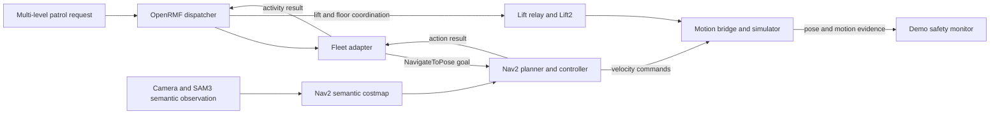

# Phase 8 OpenRMF semantic navigation demo

## Purpose and current result

Phase 8 demonstrates one robot completing an OpenRMF-dispatched Nav2 patrol
from the L1 spawn to the L3 hallway and back to the same L1 spawn. On L1,
OpenShift AI-served SAM3 supplies semantic costs that make Nav2 route around a
red mat placed across the direct spawn-to-lift route. RMF coordinates the floor
transition and Lift2; Nav2 controls the robot on each floor. This is a focused
demo, not production qualification.

The latest full run on 2026-11-13 passed the independent audit:
`patrol.dispatch-71ef8eb28b` completed L1 → L3 → L1 and stopped within 0.019 m
of `phase8_spawn`. Minimum physical mat clearance was 0.625 m, and moving
semantic plans cleared it by at least 0.651 m. The audit recorded 13 moving
semantic plans after the return to L1. Average odometry speeds from moving
Nav2 plan samples were 0.654 m/s on L1 and 0.620 m/s on L3, with a 0.707 m/s
maximum. Interior elevator travel averaged about 0.58 m/s in both directions.
The independent audit passed the floor-transition, lift-support, clearance,
and final-pose checks.

The latest measured L3 corridor-to-cabin interval was about 40 seconds,
including lift arrival and door timing. Lift boarding uses a faster,
distance-based deceleration ramp; Nav2 velocity smoothing and Gazebo pose
feedback also run at higher rates to make motion smoother in noVNC. The earlier
[Phase 6 readiness report](../phase-6-demo/semantic-cost-nav-readiness-20261110/README.md)
describes the semantic-costmap behavior carried into this profile.

## L1 mat placement

The Phase 8 mat sits across the direct L1 route from spawn `(15.402, -31.594)`
toward Lift2. It is centered at `(15.1385, -30.1804)`, measures `1.0 × 1.4 m`,
and is rotated `1.755291 rad`. The trial uses this same oriented geometry for
semantic-costmap samples, plan clearance, and physical trajectory checks.
Nav2 plans around the served-SAM3 mat costs on the way to the lift and again on
the return to spawn.

## OpenShift AI serving status

Phase 8 uses the OpenShift AI KServe `sam3-mat-v1` service for SAM3 inference.
The adapter connects over mutual TLS, checks the pinned model identity, and
publishes validated semantic observations to Nav2's costmap interface. The
latest stationary preflight found live cost-254 mat cells and a planned path
with 0.520 m hull clearance, without sending a navigation goal. The latest
full RMF patrol and independent audit also passed with the served backend.
The model server performs image segmentation only; it has no ROS graph or
motion interface. The ROS adapter pairs each response with retained depth and
camera calibration, and Nav2 turns the validated result into obstacle costs.
This is the same semantic-costmap path used by the Phase 6 navigation profile.

## What OpenRMF and Nav2 do

OpenRMF and Nav2 have different jobs in this demo. OpenRMF handles the fleet
task: it receives a request to go to a named place, chooses and assigns the
robot, tracks the task in fleet state, and expects an activity result. Nav2
handles movement of the robot through the map: it plans a collision-aware path,
controls the base along that path, and reports whether the navigation action
reached its goal.

The handoff works as follows:

1. The trial submits an OpenRMF patrol with places `L3_middle_hallway` and
   `phase8_spawn`. RMF owns the task, itinerary, fleet state, and lift requests;
   it does not calculate wheel commands.
2. The fleet adapter translates each RMF itinerary segment into a Nav2
   `NavigateToPose` goal. There is no second direct Nav2 goal from the trial.
3. Nav2 plans on each floor. Its L1 global costmap includes validated SAM3
   costs for the red mat, so the robot routes around it on the way to Lift2 and
   on the return to spawn.
4. At floor transitions, the adapter and lift relay coordinate Lift2,
   physical cabin boarding, map changes, and Nav2 localization. The elevator
   moves the robot between L1 and L3; Nav2 handles horizontal movement within
   each floor.
5. The trial checks live semantic plans, floor changes, lift support, and the
   independently measured Gazebo trajectory. It cancels the RMF task if a
   physical safety gate fails.
6. After Nav2 goals succeed and the final physical pose is validated, the
   adapter reports completion to RMF. RMF returns the fleet to idle at the L1
   spawn.



The planner and controller remain Nav2 components. OpenRMF decides and tracks
the fleet task; its adapter translates that task into navigation actions and
returns the result. The SAM3 perception stream supplies semantic observations;
the costmap turns validated observations into obstacle costs that Nav2's
planner can avoid. RMF does not create those semantic costs, and the Phase 8
demo does not bypass them with a hand-authored route around the mat.

SAM3 runs as the `sam3-mat-v1` KServe `InferenceService` in the
`semantic-model-serving` project. The ROS adapter sends bounded single-flight
requests to the cluster-local HTTPS endpoint over mutual TLS, verifies the
served model identity against a pinned manifest, then pairs each response with
its retained depth and camera calibration. The model server performs image
segmentation only; it has no ROS graph or motion interface. The ROS adapter and
Nav2 costmap convert validated results into the same semantic topics and map
costs used by the Phase 6 navigation profile. This isolates model serving from
robot navigation while allowing Phase 8 to verify the end-to-end path.

## How to run and review

Use the current multi-level Helm profile and monitored trial described in the
[Multi-level hotel profile](#multi-level-hotel-profile) below. The deployment
starts idle. Review the staged scene in noVNC, run the stationary preflight,
then explicitly dispatch the RMF patrol. A successful preflight alone is not a
navigation pass; the complete trial and independent saved-result audit must
both pass.

## Multi-level hotel profile

The multi-level profile **passed** the complete served-SAM3/RMF/Nav2 trial on
2026-11-13: task `patrol.dispatch-71ef8eb28b` completed L1 → L3 → L1 and ended
idle at `phase8_spawn`. The independent audit verified both floor transitions,
successful Nav2 actions, lift support, semantic mat costs after returning to
L1, and the final physical pose. The latest run retained 0.625 m physical mat
clearance. Earlier recovery details are in the
[corrective validation report](../phase-8/multilevel-recovery-fix-20261111/README.md).

The profile accepts new observations only within 0.5 seconds of capture. Its
fixed-scene setting allows an already accepted observation to keep the layer
current for up to 5 seconds between captures; the mat memory survives turning
away from the camera. This is an explicit static-demo setting, not a relaxation
of incoming observation validation. Ordinary planning retries cannot clear the
semantic layer. Floor transitions still reset the map and semantic memory.
Replanning occurs every 0.20 m of translation, so new paths do not repeatedly
reset the controller's final heading adjustment while the robot is stationary.

The simulator profile uses a 5 ms physics timestep and a 1.0 m/s maximum cabin
speed, with 0.6 m/s² maximum and 0.5 m/s² nominal cabin acceleration. A
temporary Gazebo fixed joint carries the wheel-driven robot during
lift travel. The relay waits for attachment acknowledgment before forwarding a
floor-change request, and the adapter waits for detachment at the open, stopped
landing before Nav2 exits. This replaces unreliable contact-only payload
support; it does not set or teleport the robot pose. Its lift-region occupancy
maps restore walls from the simulator collision meshes and keep paths within
the platform. This corrects the inherited graph-lane clearing that erased part
of the L3 shaft wall. The mat area is unchanged by this map repair: mat costs
still come from served SAM3 observations.

The `helm/phase8-multilevel-demo` profile runs the single-robot hotel route
`phase8_spawn (L1) -> L3_middle_hallway (L3) -> phase8_spawn (L1)` over the
hotel lift lanes. The red mat is across the L1 spawn-to-lift route; the Phase 6
mat placement remains unchanged.
SAM3 inference remains on the OpenShift AI `sam3-mat-v1` HTTPS service; the
adapter uses mutual TLS and the pinned model identity. Gazebo capture timestamps
are bridged into ROS alongside RGB-D so the costmap accepts only fresh model
observations.

OpenRMF dispatches the named-place patrol and coordinates the lift/floor route.
The existing hotel fleet adapter converts each RMF activity to Nav2 goals. On
each floor transition it loads that floor's map, restarts Nav2 lifecycle nodes,
clears the local and global costmaps, and initializes AMCL on the new floor.
Measured simulator pose supplies the localization transform for this demo. Nav2 plans and
controls the robot on each floor; its global costmap includes the Phase 6
semantic layer, which marks the served-SAM3 red-mat detections as lethal costs.
The simulator starts idle and no navigation task is sent until the operator
explicitly dispatches it. Nav2's desired linear velocity is 0.70 m/s; its
velocity smoother runs at 50 Hz with 0.8 m/s² acceleration and 1.0 m/s²
deceleration limits. In the latest run, moving-plan odometry averaged 0.654 m/s
on L1 and 0.620 m/s on L3. The RMF adapter publishes pose updates at 4 Hz so
fleet state tracks the faster robot without relaxing the 0.75 m divergence
guard.

The lift-entry relay moves the robot into the cabin at up to 0.24 m/s, twice
the earlier 0.12 m/s command. It uses a distance-based stopping profile, and
Phase 8 supplies it with Gazebo pose updates at 20 Hz. This smooths the short
L3 corridor-to-cabin maneuver while retaining a slow final approach. The latest
L3 corridor-to-cabin interval was about 40 seconds, including lift arrival and
door timing; interior elevator travel averaged about 0.58 m/s in each
direction.

Deploy the multi-level profile with the built image:

```sh
helm upgrade --install phase8-multilevel ./helm/phase8-multilevel-demo \
  --namespace semantic-navigation \
  --wait --timeout 20m
```

Check the staged scene at the route's `/vnc_lite.html` path, then run the stationary
preflight. This checks served inference, L1 localization, lethal semantic cells
on the mat through Nav2's live master-cost query, and a Nav2 path with at least
0.20 m hull clearance. It does not send a navigation goal:

```sh
oc exec -n semantic-navigation deploy/phase8-multilevel-hotel \
  -c hotel-nav2-rmf -- bash -lc \
  'export ROS_HOME=/tmp/ros-home/.ros \
   ROS_LOG_DIR=/tmp/ros-home/.ros/log ROS_DOMAIN_ID=42 \
   RMW_IMPLEMENTATION=rmw_cyclonedds_cpp \
   CYCLONEDDS_URI=file:///phase8-config/cyclonedds.xml; \
   source /opt/ros/jazzy/setup.bash; \
   source /opt/rmf_demos_ws/install/setup.bash; \
   python3 /opt/ros2-demo/scripts/phase8_multilevel_trial.py --preflight-only'
```

Get the noVNC route host with:

```sh
oc get route phase8-multilevel-novnc -n semantic-navigation \
  -o jsonpath='https://{.spec.host}/vnc_lite.html?autoconnect=true&scale=true{"\n"}'
```

After noVNC review and explicit operator approval, run the monitored RMF patrol:

```sh
oc exec -n semantic-navigation deploy/phase8-multilevel-hotel \
  -c hotel-nav2-rmf -- bash -lc \
  'export ROS_HOME=/tmp/ros-home/.ros \
   ROS_LOG_DIR=/tmp/ros-home/.ros/log ROS_DOMAIN_ID=42 \
   RMW_IMPLEMENTATION=rmw_cyclonedds_cpp \
   CYCLONEDDS_URI=file:///phase8-config/cyclonedds.xml; \
   source /opt/ros/jazzy/setup.bash; \
   source /opt/rmf_demos_ws/install/setup.bash; \
   python3 /opt/ros2-demo/scripts/phase8_multilevel_trial.py --dispatch --timeout 2400'
```

The trial records RMF dispatch and floor state, lift states, Nav2 action
results, semantic costmap history, moving plans, and independent Gazebo physical
poses. The monitor cancels on a fall, loss of upright support, stale physical
pose, or entry into the mat clearance boundary. Lift boarding uses this physical
pose and requires the cabin to be stopped with its door open. The robot uses
the Phase 6 rear caster supports. For this simulator-only profile, Gazebo's
measured x/y/yaw supplies planar odometry, with the hotel's common floor origin
providing map-to-odometry TF. Wheel odometry remains available as `wheel_odom`.
AMCL receives each floor map and initialization but does not publish TF: the
hotel drawing's localization mismatch and wheel slip must not displace the
semantic map from the physical robot. This simulated localization fixture
neither drives nor teleports the robot; Nav2 controls floor motion and the lift
relay controls physical boarding. The separate physics monitor retains full
3-D pose to verify support, lift elevation, and mat clearance. The passing
full-run evidence includes both floor transitions and safe moving plans before
and after the L1 map reset. For subsequent runs, require both the
monitored trial and the independent saved-result audit to pass; a stationary
preflight alone does not sign off lift travel. Copy the trial output
`/tmp/phase8-multilevel-result.json` from the demo pod, then audit it locally:

```sh
python3 demo/phase8_multilevel_audit.py phase8-multilevel-result.json
```

## Demo scope

The multi-level profile has passed the single-robot L1 → L3 → L1 route on the
hotel lift graph, including both lift transitions and served semantic mat
avoidance. This is a demo use case, not production qualification. It does not
qualify moving obstacles, multi-robot traffic conflicts, arbitrary fault
recovery, or production service availability.
