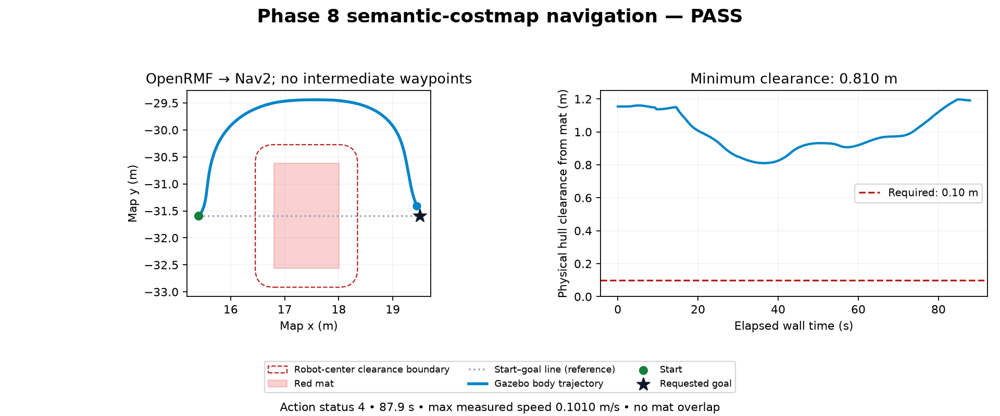

# Phase 6 fix carried into Phase 8 — PASS

The OpenRMF-dispatched semantic navigation demo passed on 2026-11-11. This
supersedes the earlier Phase 8 result where the moving robot crossed the mat.
The robot is stopped at the destination with all measured velocity components
zero. The isolated Phase 8 topology remains running for review.

## Implementation

Phase 8 builds its Nav2 pod and private navigation ConfigMap from the accepted
Phase 6 D2 renderer, rather than inheriting arbitrary live pod parameters. The
base fix is commit `1e83697f4`; the pinned plugin image is
`semantic-nav2@sha256:5a951c79f08804ec7c19512feb0de77e9b9a015463da09d2c4f05bf97e983935`.
It preserves 300-second fixed-obstacle memory, capture freshness and epoch/reset
clearing, 1.0 m global inflation, final-heading rotation, the Phase 6 TF source,
and the epoch-aware SAM3 producer. The simulator is recreated before navigation
starts, so both world pose and wheel odometry reset together.

`phase8_semantic_trial.py` reuses the Phase 6 trial gates. Its dispatch hook sends
an RMF task API request; only the RMF adapter sends the Nav2 goal. Cancellation
uses the correlated RMF task API. Completion requires terminal Nav2 success, the
correlated task observed in fleet state and subsequently idle, and independent
Gazebo pose at the checked destination. The monitor records every global plan,
semantic-cell history, and body trajectory throughout the run.

Phase 8 retains its existing matching velocity-subscriber bridge rule in a
private ConfigMap. Startup waits for active navigation lifecycle nodes. A missing
motion DDS reader permits one same-digest bridge restart followed by the complete
preflight again; other failures restore Phase 6 and save diagnostics. The final
successful startup needed no bridge restart.

## Live result

| Check | Result |
| --- | --- |
| RMF task | `compose.dispatch-7f9faace79` |
| Requested endpoint | `(19.5, -31.594)`, no intermediate waypoints |
| Nav2 goal | `bad6f844141e4fb3a3c0fe6966fe6b88`, SUCCEEDED (4) |
| Adapter completion | Confirmed after Nav2 success and pose validation |
| RMF fleet state | Task observed, then idle |
| Duration | 87.878 s |
| Minimum physical hull clearance | 0.8105 m; required 0.10 m |
| Minimum monitored global-plan hull clearance | 0.6268 m |
| Captured global plans | 83 total, including 70 while moving |
| Minimum clearance in captured moving plans | 0.7936 m |
| Semantic cost-254 cells | 961–1105 |
| Maximum measured body speed | 0.1010 m/s; cap 0.10 + 0.005 tolerance |
| Mat overlap / collision intervention / monitor breach | None |
| Stopped velocity | Zero linear and angular velocity |



## Evidence and checks

- [Summary](semantic-navigation-summary.json) and [complete plans/trajectory](semantic-navigation.json).
- [Shared no-motion preflight](nav2-semantic-path-preflight.json).
- [Stopped pose](stopped-pose.yaml), [adapter log](rmf-adapter.log), [Nav2 log](nav2.log), and [RMF log](rmf-core.log).
- [Accepted navigation ConfigMap](accepted-nav2-config.json), [bridge clone](phase8-bridge-config.json), and [live pod](phase8-runtime-pod.json).
- 45 Phase 6 demo tests and 14 Phase 8 tests passed. Python compilation and diff whitespace checks passed. The unchanged pinned C++ plugin previously passed 31 tests.

Two initial startup attempts stopped before motion: the first exposed early
velocity-smoother discovery; the second exposed the missing bridge reader after
removing the Phase 8 velocity-route rule. Active lifecycle admission and retaining
that rule corrected these startup failures. Diagnostic records are in the sibling
`phase6-fix-carryover-20261111` and `phase6-fix-carryover-ready-20261111` directories.

This is a fixed-scene, one-robot, one-floor demo result. It does not qualify
production operation, shared-space traffic conflict handling, changing obstacles,
or floor transitions. Moving cancellation was demonstrated in the earlier Phase 8
run; this carryover run validates navigation completion and live semantic avoidance.

## Restore

Run from the repository root to restore the saved Phase 6 pods:

```sh
python3 scripts/semantic-navigation/phase8_topology.py down --evidence-dir docs/validation/semantic-navigation/phase-8/phase6-fix-carryover-validated-20261111
```
