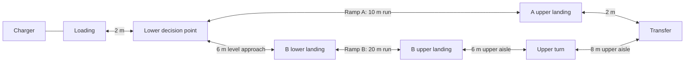

# Warehouse energy fixture v1

Date: 2026-11-16. **Qualified and frozen for Stage 1 within the simulation scope.**
The final live route-series result is recorded in the [Phase 0 report](phase-0-report.md).

This supersedes the [v0 candidate](fixture-specification.md). The machine-readable
specification is [fixture-v1.json](../../../../config/warehouse-energy/fixture-v1.json).
The numerical energy/evaluation targets from v0 remain unchanged. Qualification
does not establish a battery-energy model or any energy saving.

## Frozen physical envelope

| Parameter | Qualified design |
| --- | --- |
| Robot | Custom simulation differential drive, 1.653 kg empty |
| Payloads | 0, 0.25, 0.50 kg; maximum 0.50 kg at the specified placement |
| Payload body | 0.10 × 0.10 × 0.05 m box, center (-0.06, 0, 0.165) m in physical base frame |
| Payload dynamics | Explicit mass, box inertia, collision and fixed joint; changed only on fresh-world initialization |
| Wheel radius/separation | 0.033 m / 0.288 m, matching the SDF wheel centers |
| Wheel drive | Force-mode velocity PID, P=0.05, I=0.1, integral bound ±0.08 |
| Per-wheel effort/velocity bounds | ±0.080 Nm / 8 rad/s |
| Wheel joint friction | 0.001 Nm, a simulation design assumption |
| Command speed/acceleration | 0.10 m/s / 0.10 m/s² |
| Ramp rise | 0.20 m on both routes |
| Horizontal ramp lengths | A: 10 m; B: 20 m |
| Transitions | 1 m cosine-slope entry and exit; continuous tangent; closed mesh sampled at 0.05 m |
| Maximum ramp grades | A: 2.222%; B: 1.053% |
| Physical corridor width | 1.50 m |
| Static traversable map width | 1.40 m; 0.246 m robot radius; 0.35 m inflation |
| Dynamics timestep | 0.002 s |

Both surface conditions are currently the same uncalibrated simulator contact
surface. The original 1 m rise and different-surface experiment remain
unqualified. Do not extrapolate the envelope to a stock TurtleBot or hardware.

The full warehouse's B exit deck is clipped at the ramp's side boundary, with
its top pad beginning at x=22 m. It does not overlap the rising surface. This
corrects the collision lip found in the retained development run.

Gazebo's force-mode JointController explicitly bounds its PID force/torque
output; it replaces the inherited direct velocity drive. The telemetry plugin
records force commands and actual joint velocity before physics consumes those
commands. This is actuator evidence, not a measurement of battery-terminal
electrical power. [Gazebo 8 controller contract](https://gazebosim.org/api/sim/8/classgz_1_1sim_1_1systems_1_1JointController.html)

## Physical qualification

The [predeclared protocol](../../../../config/warehouse-energy/qualification-protocol-v1.json)
requires 36 fresh-world trials: route × direction × payload × three repetitions.
All 36 passed, and a separate implementation audited their raw pose and torque
traces, physical mass, controller configuration, support, clearance and endpoints.
Each traversal included braking, a stationary observation on the slope, restart,
and a final stopped endpoint. No teleportation occurred during a trial.

Across the matrix:

- Maximum recorded motor torque command: **0.05640 Nm** (limit 0.080 Nm).
- Maximum physical translational speed: **0.10177 m/s**.
- Maximum support-height error during active traversal: **0.039 mm**.
- Minimum chassis clearance: **9.32 mm** (required ≥1 mm).
- Maximum roll/pitch: **0.000174 / 0.025205 rad**.
- Maximum drift during the stationary ramp hold: **0.0061 mm**.

These unusually small deviations describe a deterministic, idealized simulated
fixture. They are not estimates of physical-robot uncertainty or statistical
reliability. Three repetitions establish reset reproducibility, not population
coverage. See [independent audit](qualification-20261116/ramp-audit.json),
[summary](qualification-20261116/ramp-summary.json) and
[raw evidence archive](qualification-20261116/ramp-evidence.tar.gz).

## Coordination and scope

Retain the complete directed RMF graph with both ramps. Submit one composed
task with ordered intermediate `go_to_place` activities for the selected route.
The Nav2 map admits only that corridor. Evidence must show the selected waypoint
sequence in the physical trace, adapter-submitted Nav2 goals, RMF itinerary, and
the schedule server's accepted mirror updates. The final four-case series passed,
including all 20 Nav2 goal results, physical waypoint sequences and stopped-wheel
completion checks.

The fixture uses planar Gazebo ground truth for Nav2 and a separate full-pose
trace for physical checks. Cameras and laser sensors are disabled in these
empty-corridor capability tests. Warehouse SAM3 exclusions, pitched-camera TF,
laser handling and sensor-based localization remain explicit Stage 1 integration
work. The passing hotel SAM3 baseline remains preserved separately.

Energy boundary, battery assumption, reserve and deadline targets are unchanged:
simulated robot battery terminals; no regeneration; 24 Wh design assumption;
80% initial SOC; 20% reserve after mission and charger access; 900 s one-way and
1800 s round-trip deadlines. Phase 0 does not enforce energy-based reserve: its
RMF SOC is an explicitly simulated fixed 80% placeholder. Stage 1/2 must replace
it with validated energy accounting before claiming reserve feasibility.

The implementation agent owns the simulation implementation and validation work.
This specification receives an implementation review against the independent
audit, unit checks and live route evidence; no separate human sign-off is claimed
or required by the approved execution scope. Physical-robot ownership remains
unassigned because hardware Stage 5 is outside this work.
