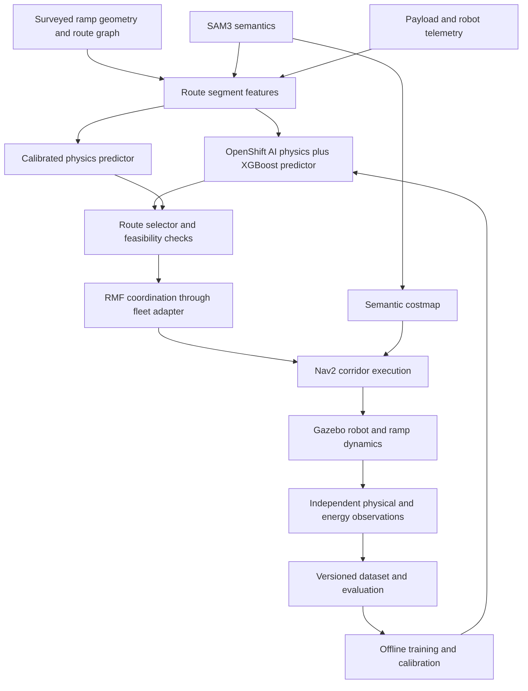

# Energy aware warehouse navigation proposal

**Date:** November 16, 2026  
**Status:** Approved by the user on November 16, 2026  
**Stakeholder summary:** the completed Stages 0–4 outcome and benefits are summarized in
[warehouse-energy-stakeholder-summary.md](warehouse-energy-stakeholder-summary.md).  
**Selected energy model:** Calibrated physics model plus an XGBoost residual predictor  
**Scope:** One warehouse robot navigating ramps in simulation using OpenRMF, Nav2, SAM3, and OpenShift AI model serving  
**Approval scope:** Stages 0 through 4, including simulation data collection, offline XGBoost residual training, OpenShift AI serving, and comparative evaluation. Stage 5 hardware validation remains a separate follow-on. Approval records the design decision; it does not indicate implementation or validation completion.

**Implementation:** Stage 0 completed November 16, 2026 for the frozen simulation fixture. The pinned hotel baseline, 36 ramp/payload trials, four live RMF/Nav2 route trials and independent audits passed. **Stage 1 completed and accepted with reviewer sign-off November 17, 2026.** Modeled battery-energy/SOC accounting passed all four route/direction trials at both 640×480 and 320×240. RGB-D, capture-time camera TF, and independent energy audits passed at 320×240 and 10 Hz in all four route/direction cases; 640×480 throughput remains below target. The frozen SAM3 `red mat`/`avoid-target/v1` policy passed one integrated costmap route in each direction on both ramps without changing controller or collision settings, and the November 16–17 repeated-run series passed three audited repeats per route/direction after the B-route red mat was moved from `[7.0, 6.3]` to `[7.0, 6.5]` m to eliminate a reproducible B-up planner block. Other objects, 640×480 semantic behavior, and physical electrical calibration remain open or out of scope. **Stage 2 completed November 17, 2026.** The planning physics model was calibrated on the 36 dedicated Phase 0 runs (RMSE 0.000276 Wh, weak Crr/efficiency identifiability documented, pod-reproduced byte-identically) and frozen to `config/warehouse-energy/physics-model-v1.json`. The planning-time route selector enforces the one-way deadline and the post-mission-plus-charger-access reserve; arm A (distance) and arm B (physics energy) each passed three repeatable live trials selecting route A — the honest physics result for the same-surface fixture, since route B's longer traverse costs more auxiliary and rolling energy. A route-A exclusion scenario selected and executed route B, and a low-SOC mission was rejected before motion with an explicit reserve reason. Across the seven motion trials, prediction MAE was 0.0090 Wh and all itinerary/correlation, deadline, and reserve checks passed under independent audit. No energy saving is claimed; both arms selecting the same route is recorded as a physics outcome, not tuned away. **Stage 3A completed November 17, 2026.** The frozen sweep design collected 96 instrumented runs (72 scripted traversals with controlled stop profiles and speeds, 24 forced-corridor RMF/Nav2 missions) across both ramps and directions, all three payloads, and speeds at or below the qualified cap; all trials passed and zero runs were rejected. The versioned dataset segments them into 312 rows pairing planning-time features with modeled Wh labels, frozen physics estimates, and residuals, under complete-run partitions (42 residual-train, 14 development, 13 uncertainty-calibration, 27 final-test runs holding out the scripted 0.25 kg payload combination and the navigation B-up-at-0.08 m/s combination). Scripted residuals reconcile with the physics at 0.0002 Wh MAE; navigation residuals average −0.008 Wh, the structured goal-transition correction Stage 3B will learn. The independent audit recomputes every label from the raw traces and passed after an initial descending-run window defect was caught and fixed. **Stage 3B completed November 17, 2026.** A reproducible CPU training job in the pinned pod (vendored xgboost 2.1.4, seed 17, single thread) trained the residual regressor on the training partition, selected bounded hyperparameters on the development partition by mission-energy MAE, calibrated mission-level uncertainty allowances on the separate calibration partition, and froze the versioned release (`config/warehouse-energy/energy-model-release-v1/`, frozen-portion SHA-256 recorded) before the held-out test was opened exactly once. On the 27 held-out missions, physics-plus-XGBoost cuts mission-energy MAE 77.4% versus the frozen physics baseline (0.000680 vs 0.003011 Wh), against 29.1% for the linear-residual comparison, with zero physical-bounds rejections and 96.3%/100% upper-estimate coverage for the learned/fallback modes. The independent audit reloaded the artifacts through a separate inference path, recomputed every metric, and verified a byte-identical retrain. No route-choice or energy-saving claim is made. **Stage 3C completed November 17, 2026.** The frozen release is deployed as the `energy-predictor-v1` OpenShift AI CPU InferenceService (one warm replica, digest-pinned image verified from the pod status, cluster-local mTLS data port, ingress-isolated to labeled warehouse clients). The qualification suite passed all eleven checks: model identity; offline/server combined-prediction and local/server physics parity on 96 replay segments within 1e-9 Wh; wrong-version, out-of-envelope, oversized-batch, malformed-response, and stale-generation rejection; documented physics fallback with the frozen conservative allowance when the endpoint is unavailable; cache reuse across planning generations; and p95 latency of 69.5 ms for the 32-segment batch against the 250 ms target. One platform adaptation is recorded: OpenShift AI 3.5.2 injects an auth proxy on pod port 8443 for new services, so the mTLS data port listens on 8090 behind the TLS Service. **Stage 4 completed November 17, 2026.** The frozen A/B/C experiment executed all 121 planned missions (90 one-way across six strata, 15 arithmetically chained round trips, one fallback demonstration) with zero failures under a deterministic seeded order. Arm C improves mission-energy prediction MAE 96.8% over arm B (0.001138 vs 0.035405 Wh, target 20%) with 100% upper-estimate coverage in both modes, +0.02% completion time versus arm A, and 100% route/itinerary agreement; the fallback demonstration selected and completed on the documented local-physics path with the endpoint unreachable. Aggregate mission energy is statistically indistinguishable across arms (all paired 95% intervals include zero) because every arm selects the same energy-optimal corridor in this same-surface fixture — the explicit AI-value decision is therefore **prediction result only**: retain the physics planner for route selection here and the served predictor where prediction accuracy matters; an energy-routing benefit requires conditions where the estimators disagree on the corridor. The independent audit reconciled every observation, all 80 served route predictions against frozen offline expectations, and the round-trip chaining. No energy saving is claimed. **Stages 0 through 4 of the approved scope are complete; Stage 5 (hardware study) remains a separate follow-on.** See the [Stage 0 report](validation/warehouse-energy/phase-0/phase-0-report.md), [Phase 1 report](validation/warehouse-energy/phase-1/phase-1-report.md), [repeatability series](validation/warehouse-energy/phase-1/sam3-repeatability/README.md), [Stage 2 report](validation/warehouse-energy/phase-2/phase-2-report.md), [Stage 3A report](validation/warehouse-energy/phase-3a/phase-3a-report.md), [Stage 3B report](validation/warehouse-energy/phase-3b/phase-3b-report.md), [Stage 3C report](validation/warehouse-energy/phase-3c/phase-3c-report.md), and [Stage 4 report](validation/warehouse-energy/phase-4/phase-4-report.md).

## Recommendation

Extend the existing navigation framework with a warehouse demonstration in which a robot selects a route based on predicted battery energy consumption. Use two alternative ramps between a lower loading area and an elevated transfer area. Compare the existing distance-based routing baseline, a calibrated physics-based energy planner, and the same energy planner using predictions from a model served by OpenShift AI.

Use a calibrated physics model plus an XGBoost residual predictor as the selected energy-estimation approach. The physics model supplies the baseline and local fallback; XGBoost learns the remaining segment-energy error from observed traversals. Serve the combined predictor through OpenShift AI on CPU. This is a robot-specific model to calibrate and train, not a pretrained energy model to download.

Train the first deployable model offline using instrumented warehouse simulations. Hardware data collection is not a prerequisite for the simulation demonstration. The resulting artifact is trained before deployment for this robot and fixture; simulated performance does not establish real battery savings.

The proposed customer outcome is a robot that completes a delivery within its time and battery constraints while adapting its route to payload, ramp direction, and floor conditions. The demonstration should show why a route was selected, predicted versus consumed energy, remaining battery reserve, and the model version responsible for the prediction.

Proceed as a bounded research prototype. Energy-aware navigation is technically credible, but the improvement from learned inference must be measured against a strong physics baseline. A successful platform integration and a demonstrated energy saving are separate outcomes. No saving percentage is established for this framework today.

## Research questions and evidence

The primary question is whether a learned energy predictor produces better route choices than a calibrated physics model for a warehouse robot traversing ramps with changing payloads. A second question is whether centralized model serving can provide those predictions reliably without becoming a dependency of the robot's motion-control loop.

Prior work supports the approach. CAMIS models direction-dependent energy and stability costs on inclined surfaces, including a field experiment with a skid-steering robot. This supports representing each ramp direction separately. [CAMIS research](https://arxiv.org/abs/2103.03849)

The Conv1D Energy-Aware Path Planner learns energy consumption from terrain profiles and reports a 5.5% driving-energy reduction in its simulation comparison against an inclination-based model. Its robot, terrain, and experiment differ from this warehouse proposal; that result is evidence of feasibility, not a forecast for this project. [Conv1D research](https://arxiv.org/abs/2104.01560)

The physics also places limits on the opportunity. Two monotonic ramps connecting the same endpoints require the same gravitational work for a given mass. A longer, gentler ramp is not automatically more efficient. Route differences must come from rolling resistance, drivetrain efficiency, traversal time, acceleration, turning, or additional climbs and descents. If these effects do not produce meaningful route differences, the experiment should report that result rather than tune the world to guarantee an AI win.

## Warehouse scenario

Use a small warehouse with a lower loading station, an elevated transfer station, a charger on the lower level, and two nonoverlapping ramp corridors. Place decision points and safe stopping areas before and after each ramp. Keep the initial geometry free of vertically overlapping aisles so that a planar navigation map remains unambiguous.

| Route | Proposed geometry | Purpose |
| --- | --- | --- |
| A | Short approach and a relatively steep ramp | Lower distance and duration, potentially higher traction demand |
| B | Longer approach and a gentler ramp | Alternative drivetrain operating conditions with a distance and duration penalty |
| Optional later route | Different surface or an intermediate rise and descent | Broader generalization after the two-ramp experiment is established |

An initial simulation candidate is a 1 m rise with approximately 10 m and 20 m horizontal ramp runs, corresponding to 10% and 5% grades. These are proposed fixture dimensions, not approved operating limits. Final grades, widths, transitions, braking limits, and speed caps must fit the selected robot's validated capabilities. If the inherited hotel robot cannot traverse the candidate ramps reliably, reduce the grades or select a documented warehouse robot model before collecting energy data.

Run unloaded, medium-load, and high-load conditions defined as 0%, 50%, and 100% of the selected robot's permitted payload. Freeze actual masses and payload placement during fixture qualification. Model payload mass and inertia physically; a visual cargo object alone is insufficient. Begin with the same surface on both ramps, then introduce separately calibrated surface patches as a second experiment.

Evaluate both uphill and downhill trips, followed by loaded outbound and empty return missions. The round-trip result matters because a route that benefits one leg may not minimize total mission energy. Payload attachment or removal occurs only at a stopped station and must be recorded in the mission trace.

### Demonstration sequence

1. Display the warehouse, ramp profiles, payload, battery reserve, and candidate route estimates.
2. Execute the distance-based baseline from loading station to transfer station and back.
3. Repeat under matched conditions with physics-based energy routing and learned energy routing.
4. Compare consumed Wh, completion time, route selection, and prediction error across all three runs.
5. Change payload or a qualified surface condition and show the resulting predictions and route choice. A route change is not required if the same route remains best.
6. Make the energy endpoint unavailable before a new route decision and demonstrate the documented physics fallback.

## Scope and exclusions

The first prototype includes one robot, a static warehouse, two ramps, known geometry, a controlled payload set, directed route selection, energy telemetry, a separate energy inference service, and reproducible comparison trials. Retain the existing SAM3 semantic exclusions as a navigation constraint. Add surface recognition only after its labels have been validated for the warehouse fixture.

Initial localization may use the existing simulator ground-truth pose approach, explicitly labeled as such. Physical motion, ramp contact, and consumed energy still require independent observation. Ground-truth localization does not demonstrate deployment-ready warehouse localization.

The prototype does not qualify shared-ramp fleet traffic, production safety, autonomous 3D mapping, real-world battery life, regenerative braking, elevator energy, fleet-wide charging optimization, or an end-to-end learned driving policy. Physical-robot trials are a subsequent validation stage. A ROS distribution upgrade is not a prerequisite unless the chosen integration cannot be supported on the pinned baseline.

## Existing foundation and required changes

The accepted hotel demonstration completed RMF-dispatched L1 to L3 and return navigation with served SAM3 and Nav2. Its validation record provides the integration baseline, not evidence of ramp capability or energy accuracy. [Multilevel validation record](validation/semantic-navigation/phase-8/multilevel-recovery-fix-20261111/README.md)

| Existing component | Reuse | Required extension |
| --- | --- | --- |
| OpenRMF dispatch and local fleet adapter | Task lifecycle, cancellation, execution correlation | Route-choice coordination and real or simulated battery updates |
| Nav2 Navfn and Regulated Pure Pursuit | Local planning and motion execution | Ramp-qualified configuration and enforcement of the selected corridor |
| SAM3 and semantic costmap | Validated semantic exclusions and served inference contract | Warehouse recognition checks; optional calibrated surface features |
| OpenShift AI custom serving pattern | Authentication, model identity, health, deployment isolation | A separate CPU-first energy prediction service |
| Gazebo and independent physics monitor | Repeatable scenes and physical trajectory evidence | Ramp geometry, payload dynamics, attitude and traction checks, energy instrumentation |
| Existing trial and evidence patterns | Correlated task, action, model, and physical records | Paired experiments and energy analysis |

The [current adapter](../helm/phase8-multilevel-demo/files/local_nav2_fleet_adapter.py) reports state of charge as a constant `1.0`. Replace it with measured or explicitly simulated state of charge. The [odometry fixture](../helm/phase8-multilevel-demo/files/phase8_sim_odometry.py) projects motion into a planar frame. Preserve a planar Nav2 interface where appropriate, but maintain separate full-pose and elevation information for ramp execution checks and energy features.

The [current planner configuration](../helm/phase8-multilevel-demo/files/hotel_nav2_params_phase8_multilevel.yaml) uses Navfn. Elevation-dependent battery cost cannot be faithfully represented by one scalar cost per 2D cell because uphill and downhill traversal differ. Keep semantic collision and exclusion costs in the existing costmap; represent energy in a directed route graph.

## Proposed architecture



### Route selection and motion authority

Create a small route-selection component above Nav2. Each directed edge carries segment geometry, length, elevation profile, surface metadata, speed limits, and robot capability restrictions. Candidate route costs depend on the robot and payload, not only on the map. Compare the complete mission, including stops and the return leg when applicable.

For the first fixture, use a small finite set of candidate routes and sum segment energy estimates. Choose the lowest-energy feasible route subject to a mission deadline, conservative battery reserve, and hard navigation constraints. Include energy required to reach an available charger after the mission. If no route meets these conditions, defer or reject the mission with an explicit reason.

The fleet adapter must reconcile the chosen corridor with RMF before motion starts. Verify the actual itinerary and observed path in the integration gate. The current RMF waypoint-command flow must not be silently bypassed by independent Nav2 rerouting. The implementation spike will determine whether explicit intermediate task destinations or a supported itinerary integration is the cleaner mechanism for the pinned RMF version. This is an open implementation decision, not an assumed existing API.

Use waypoints and corridor constraints sufficient to prevent a global replan from taking a different ramp. Reconsider the route at safe decision points, with hysteresis to avoid switching for small prediction changes. If a ramp becomes blocked, stop at a qualified location and coordinate a new route. Nav2 retains local collision avoidance and the independent monitor retains stop authority.

Nav2's Route Server is a possible future integration because it supports graph routing, but it was introduced in the Jazzy-to-Kilted transition. The current configuration uses Jazzy; do not assume the installed image contains it. Prefer a small external route selector for the first experiment and revisit Route Server during a separate compatibility review. [Nav2 migration guide](https://docs.nav2.org/rolling/configuration_and_development/migration_guides/jazzy/Jazzy/)

### Ramp navigation qualification

Qualify uphill travel, downhill stopping, entry and exit transitions, payload stability, and recovery before comparing energy. Check that the depth and laser processing do not interpret the ramp surface as a wall or clear genuine obstacles. Camera projection must use capture-time transforms that account for physical pitch and roll. Reusing flat-floor semantic projection without checking its geometry could create false costs on a slope.

Use a known 2.5D elevation representation keyed to the route graph. Keep full physical pose available to the independent monitor. Ramp speed, pitch, roll, traction, clearance, and braking restrictions are hard feasibility conditions; energy preferences cannot relax them.

## Energy model and inference service

### Physics baseline

Estimate traction demand from robot plus payload mass, ramp slope, rolling resistance, acceleration, and speed. Convert positive mechanical power to electrical demand using a calibrated efficiency model, then add electronics, sensors, control compute, tool loads, and waiting power. Integrate electrical power over the traversal to obtain Wh. Fit parameters on training/calibration runs and freeze them before evaluation.

For straight ramp travel, begin with the longitudinal force balance `F = m*a + m*g*sin(theta) + Crr*m*g*cos(theta)`, where `m` includes payload, `theta` is signed grade angle, and `Crr` is rolling resistance. With forward speed `v`, the traction contribution is `max(F*v, 0) / eta`, where `eta` is calibrated drivetrain efficiency in the qualified operating range. Add separately calibrated auxiliary, turning, and electrical braking demand without double counting drivetrain losses. This is a simplified wheeled-robot model; refine its parameters and turning behavior for the selected drivetrain.

Calibrate rolling resistance by surface, drivetrain efficiency across representative loads and speeds, and stationary auxiliary power. Use planned speed and dwell profiles to predict route energy; use actual telemetry only to calculate observed training labels and evaluation outcomes. The first implementation milestone is a validated physics predictor and trustworthy energy telemetry, before training XGBoost.

Use signed slope within the force balance. Downhill gravity can reduce traction demand without implying energy recovery. Start with no regeneration credit; any electrically powered braking demand must be measured or modeled. This produces nonnegative edge-energy costs and avoids introducing unsupported negative-edge behavior into the routing algorithm.

The metric boundary is the robot's battery terminals. OpenShift cluster power is outside this battery metric and must not be described as a total-system sustainability saving. A later study could measure cluster energy separately.

### XGBoost residual predictor

Train a small XGBoost regression model with segment residual energy in Wh as its target:

```text
residual_target_Wh = observed_segment_Wh - physics_segment_Wh
predicted_segment_Wh = physics_segment_Wh + XGBoost(segment_features)
```

Residuals may be positive or negative: the physics baseline can underpredict or overpredict consumption. Validate the combined estimate against physical bounds, including nonnegative energy under the initial no-regeneration assumption. Reject implausible corrections and use the physics fallback rather than silently clipping a large model error into an apparently valid prediction.

XGBoost is the selected first learned model because the initial inputs are structured segment and robot attributes. Train and tune it using complete-run splits, with bounded tree depth and model size selected on development data. Include a physics-plus-linear-residual model as a low-complexity offline comparison. XGBoost is a learning framework; robot-specific trained weights must be produced by the implementation phases below.

| Model | Role in the implementation |
| --- | --- |
| Calibrated physics model | Initial working estimator and local fallback |
| Physics plus our trained XGBoost residual | Primary model for the warehouse proposal |
| Pretrained Meta-Conv1D | Optional research benchmark; not a dependency of the first deployment |

Keep physics plus XGBoost as the primary approach. Adapting a pretrained neural model's inputs and energy definition may require more work than training a small residual predictor on warehouse traversals. The [Meta-Conv1D repository](https://github.com/picchius94/META-CONV1D) provides a candidate for a separate comparison, subject to checkpoint reproducibility, reuse terms, and compatible input and energy definitions. Its inclusion must not delay the primary training and serving path. Detailed battery electrochemical models remain outside the initial scope.

| Input group | Proposed fields |
| --- | --- |
| Geometry | Segment length, signed grade profile, cumulative ascent and descent, turns |
| Operating plan | Intended speed and acceleration profile, expected stops and dwell time |
| Robot | Robot configuration identifier, total mass, payload placement category |
| Surface | Known or validated semantic class, confidence, calibration revision |
| Battery | State of charge and temperature where reliable telemetry is available |
| Baseline estimate | Physics segment energy in Wh and planned traversal duration |

Carry map, graph, feature-schema, and calibration versions as validation and provenance metadata, not predictive features. Use physical robot parameters as model inputs; use robot identity to select the compatible configuration and reject unsupported robots.

Only information available at planning time may be an input. Actual future traversal time or measured future current must not leak into the predictor. Return expected Wh, a calibrated upper estimate, model identity, and an indication of whether the input lies within the validated operating range. Treat unknown surfaces or payloads conservatively rather than assuming the nearest label is correct.

Fit uncertainty calibration on a separate set of complete missions after model tuning. Verify the upper estimate against total mission energy, including the charger-access allowance used for reserve checks. Summing segment upper estimates does not automatically establish 95% mission coverage. Apply a separately validated uncertainty allowance to the physics fallback, and report coverage for both operating modes.

SAM3 remains the perception model. It does not estimate metric elevation or infer a trustworthy friction coefficient directly. Use geometry for elevation and measured traversals to connect surface classes to energy behavior.

### Serving contract and fallback

Deploy a separate versioned energy model using the [existing custom serving pattern](../helm/semantic-navigation/openshift-ai/render.py). Begin with one warm CPU replica, internal authenticated access, pinned model artifacts, health checks, and latency/error metrics. Confirm the installed OpenShift AI version and available runtime before choosing the model serialization format. Red Hat documents custom runtimes as an extension mechanism; the custom predictor remains a maintained project component. [OpenShift AI runtime documentation](https://docs.redhat.com/en/documentation/red_hat_openshift_ai_self-managed/3.4/html/managing_and_monitoring_models/managing-and-monitoring-models_cluster-admin)

Package feature validation, the calibrated physics calculation, the XGBoost residual model, and uncertainty calibration together. Version the feature schema, physics parameters, XGBoost artifact, dependency versions, and uncertainty calibration as one compatible release. Retain the same physics implementation and parameter revision locally for fallback, and verify local/server physics parity on fixed inputs. Return the physics estimate and residual contribution alongside the combined prediction so route decisions remain inspectable.

Batch candidate segments in one bounded request at mission planning or a safe replanning point. Include request ID, robot configuration, graph version, model version, and payload generation. Validate units, finite values, bounds, response identity, and completeness before accepting predictions. Cache results by the inputs that affect energy, including payload and model version; reject a late response from an obsolete planning generation.

Proposed initial operating targets are p95 response time below 250 ms for the qualified batch size and a 1 s request deadline. Freeze the batch-size limit during qualification. These are design targets, not observed performance. A timeout, invalid response, stale cache, or unsupported input activates the calibrated physics predictor with conservative uncertainty. If fallback cannot establish reserve feasibility, do not start the mission. Failure of the energy service does not justify relaxing existing semantic or motion safety behavior.

## Data collection and experimental design

On hardware, segment energy is the time integral of battery voltage multiplied by current, divided by 3600 to convert joules to Wh. Establish current polarity, timestamp alignment, sensor calibration, and measurement resolution. Battery percentage alone is too coarse for short-route comparisons.

In simulation, instrument wheel torque and speed, motor losses, auxiliary load, and battery discharge using a validated energy implementation. Gazebo motion alone does not establish realistic battery consumption. If only an analytical power model is available, label the result as a modeled-energy experiment and reserve physical savings claims for hardware trials.

Training the predictor and evaluating savings against the exact same formula is insufficient evidence. Use independently calibrated or higher-fidelity evaluation dynamics and held-out parameter conditions. Document the remaining simulation dependence even when training and evaluation models differ.

Record mission, task, segment, route, payload, model and map IDs; intended and actual velocity; full pose; electrical observations; predicted mean and upper energy; fallback events; semantic state; and terminal outcome. Collect data on both ramps rather than only the route preferred by the current planner.

| Arm | Route objective | Energy estimator | Purpose |
| --- | --- | --- | --- |
| A | Shortest feasible distance | Logged only | Reference navigation performance |
| B | Minimum predicted mission energy | Calibrated physics | Benefit of energy-aware planning |
| C | Minimum predicted mission energy | Physics plus served XGBoost residual | Additional benefit of learned inference |

Use the same constraints, controller, semantic policy, speed options, and route candidates in all arms. Randomize trial order and match initial conditions and simulation seeds across arms. Keep the energy comparison separate from any optional speed-optimization experiment.

Start with three payloads, two directions, and two surface conditions: 12 predefined evaluation strata. Use at least five matched A/B/C triplets per stratum for an initial 180 one-way runs, then assess whether observed variance requires more trials. Add a separately reported round-trip set. This is a pilot sampling plan, not a statistical power guarantee; freeze the final test size after a training-only variance pilot and before opening held-out results.

Split data by complete run and reserve complete payload/grade/surface combinations for generalization tests. Do not split adjacent samples from the same traversal across training and test sets. Freeze model choice, baselines, thresholds, and the scenario mix before final evaluation. Report every stratum, all failures, paired confidence intervals, and aggregate results; do not select only routes where AI wins.

Separate physics fitting, XGBoost training/tuning, uncertainty calibration, and final evaluation data by complete runs or missions. Freeze the physics parameters before generating residual targets. Keep the same physics baseline in arms B and C so their difference measures the XGBoost contribution. Report the offline linear-residual comparison alongside XGBoost prediction results; promote XGBoost into the demonstrated route-selection mode only after the prediction, uncertainty, and serving gates pass.

## Proposed acceptance criteria

The numerical targets below are review proposals. Confirm or revise them before evaluation begins.

| Area | Proposed criterion |
| --- | --- |
| Motion and task completion | All qualification missions complete or enter the expected controlled failure state; zero collisions, ramp departures, or hard-limit violations |
| Route coordination | RMF itinerary, selected ramp, Nav2 goals, and observed trajectory agree in every qualifying run |
| Measurement | Report calibration and uncertainty; measured differences must exceed the measurement uncertainty to support a savings claim |
| Prediction | At least 20% lower held-out mission-energy MAE for C than B; also report absolute Wh error and underprediction |
| Uncertainty | A nominal 95% upper mission-energy estimate achieves at least 95% empirical coverage on the predefined held-out set, with sample count and interval reported; evaluate served and physics-fallback modes separately |
| Energy-aware routing | Report B versus A independently; do not attribute this difference to AI |
| Added AI value | Target at least 5% lower aggregate mission energy for C versus B, with the paired 95% confidence interval excluding zero improvement |
| Mission utility | No battery-reserve violation and no more than 10% aggregate completion-time increase versus A; all routes meet the frozen mission deadline |
| Serving | Meet the qualified latency target; demonstrate timeout, wrong-version, malformed-response, and stale-generation rejection plus valid fallback |

Evaluate energy and time on matched successful missions and report completion rates and failed-run energy separately. A failed or prematurely stopped run cannot count as an energy saving. Report route regret against the best independently evaluated feasible candidate for the fixed scenario, where counterfactual measurement is available.

If C improves prediction but not route energy, record a prediction result only. If B improves energy but C adds no material benefit, retain the physics planner as the preferred implementation. If neither improves mission value, stop the energy-optimization expansion and document the limiting conditions. These are legitimate research outcomes.

## Delivery stages and review gates

| Stage | Work and deliverables | Exit evidence |
| --- | --- | --- |
| 0 Baseline and design freeze | Pin existing images/configuration; choose robot, ramps, payload limits, energy boundary, and route integration | Reviewed fixture specification and reproducible hotel baseline |
| 1 Ramp and telemetry qualification | Warehouse world, directed graph, stable ramp execution, payload dynamics, simulated electrical power and battery telemetry, monitor extensions | Bidirectional simulated physical traversal, energy-accounting checks, and documented simulator assumptions |
| 2 Physics routing and calibration | Calibrated physics estimator, route selector, RMF coordination, reserve/deadline checks, arm A and B runner | Frozen physics parameters, repeatable routes, and valid itinerary/path correlation |
| 3A Simulation dataset | Instrumented traversal sweeps, segment labels, complete-run split manifest, data quality report | Versioned dataset with traceable simulated Wh labels and isolated training, calibration, and test partitions |
| 3B Offline training | XGBoost residual training, linear-residual comparison, development-set tuning, mission uncertainty calibration | Reproducible trained artifact, frozen preprocessing and parameters, and held-out prediction report |
| 3C Serving qualification | OpenShift AI CPU deployment, local physics fallback, versioned model contract | Offline/server combined-prediction parity, local/server physics parity, and serving fault tests |
| 4 Comparative demonstration | Frozen A/B/C experiment, round-trip evaluation, operator view and evidence package | Complete result set and explicit AI-value decision |
| 5 Optional hardware study | Instrumented warehouse robot and qualified physical ramps | Measured transfer accuracy and real battery savings, if any |

Stages 0 through 4 are the proposed implementation scope. Stage 5 is a separate follow-on. Estimate calendar duration after Stage 1 establishes robot compatibility and the effort needed for trustworthy energy instrumentation; those are the largest uncertainties.

### Simulation training workflow

**Stage 1 establishes the label source.** Instrument simulated wheel torque and speed, drivetrain losses, auxiliary demand, and battery discharge. Check units, clock alignment, integration over time, and conservation/accounting consistency. Document which quantities come from simulated dynamics and which are assumed electrical parameters. A credible simulation model can support the first demonstration without hardware data, but its calibration provenance and remaining physical uncertainty must be explicit.

**Stage 2 establishes the working estimator.** Fit physics parameters on dedicated calibration runs and freeze the resulting configuration. Demonstrate physics-only routing and fallback before introducing learned corrections. The frozen physics estimator supplies the reference value for all residual labels and remains identical in evaluation arms B and C.

**Stage 3A collects the training dataset.** Execute both ramps in both directions across the qualified payloads, surfaces, planned speeds, and stop profiles. Use predefined parameter variations and seeds within the robot's feasible envelope. Segment each traversal consistently and calculate simulated electrical Wh from the instrumented power trace. Store planning-time features, observed energy, the frozen physics estimate, and their residual. Reject or separately label failed traversals and invalid telemetry; do not treat truncated trips as successful low-energy samples.

Create explicit partitions for physics fitting, residual training, development/tuning, uncertainty calibration, and final testing. Keep complete runs together and reserve designated condition combinations for generalization tests. The 180-run A/B/C pilot described above is evaluation work, not the training-data budget. Size the training sweeps using development-set learning curves and coverage checks without inspecting final test performance.

**Stage 3B trains the first deployable artifact offline.** Run a reproducible CPU training job in a pinned environment, optionally using an OpenShift AI workbench or batch job. Train XGBoost on simulated observed Wh minus frozen physics Wh; compare it against physics-only and a linear-residual correction. Tune on development data, then calibrate mission uncertainty on its separate partition. Open the held-out test only after freezing the model and thresholds. If a failed test leads to retraining, treat that test as development evidence and reserve a new untouched final test set.

Export the XGBoost weights, physics parameters, feature schema and preprocessing, uncertainty calibration, dependency versions, dataset/split identifiers, training configuration and seed, checksums, and evaluation report as one versioned release. Describe its scope as simulation-trained for the qualified warehouse robot and conditions. Do not imply general validity across robots, battery systems, or physical facilities.

**Stage 3C serves the frozen model.** Load the trained release into the CPU inference service without request-time training. Replay fixed inputs and verify that the complete served prediction matches offline inference within a declared numerical tolerance. Separately verify physics-fallback parity, invalid-input rejection, model identity, and timeout behavior. Qualify this release before Stage 4 route comparisons; a later model update repeats the relevant gates.

Meta-Conv1D may be evaluated as an optional Stage 3B benchmark if its checkpoint can be reproduced and its inputs and output energy can be compared fairly. Record any adaptation or fine-tuning and keep its results separate from the primary A/B/C experiment. Stage 5 would collect physical telemetry, assess transfer error, and recalibrate or retrain before making real battery-saving claims.

Required roles are a robotics engineer for ramp dynamics and RMF/Nav2 integration, an ML engineer for calibration and evaluation, and platform engineering support for serving and observability. Roles may be combined; no staffing commitment is assumed. Reuse qualified Gazebo rendering and SAM3 capacity, add a small CPU inference workload and versioned data storage, and verify actual cluster availability before scheduling trials.

Implement in an isolated warehouse profile with separate manifests, maps, and evidence directories. Preserve the accepted hotel configuration as a regression baseline. Candidate additions include `apps/energy-predictor/`, `apps/energy-routing/`, `helm/warehouse-energy-demo/`, and `docs/validation/warehouse-energy/`; final paths should follow the repository layout at implementation time.

## Risks and mitigations

| Risk | Consequence | Response |
| --- | --- | --- |
| Inherited robot or planar sensing is unsuitable for ramps | Navigation failures dominate the study | Qualify dynamics, sensor projection, and braking before energy optimization |
| Too little difference between route energy | No actionable route benefit | Run an early physics sensitivity study; report a negative result if appropriate |
| Simulated battery lacks independent fidelity | Artificial savings | Calibrate independently and distinguish modeled results from physical evidence |
| Payload or surface differs from training | Underestimated energy and reserve | Input-range checks, uncertainty bounds, conservative physics fallback |
| Nav2 departs from the RMF route | Invalid coordination or wrong energy estimate | Enforce corridor execution and audit actual itinerary/path agreement |
| Remote prediction is slow or unavailable | Delayed route decisions | Bounded batching, versioned cache, safe decision points, local physics fallback |
| Semantic surface labels are unreliable | Wrong feature attribution | Begin with known surface metadata and separately qualify SAM3 labels |

## Approval and implementation decisions

The user approved this proposal on November 16, 2026. The selected energy approach is a calibrated physics model plus an XGBoost residual predictor, served together on CPU with a local physics fallback. The approved baseline is a simulation-first, single-robot warehouse; two ramps with the same endpoints; a known elevation map; no regenerative credit; and a directed route selector compatible with the pinned ROS baseline.

During Stage 0, resolve the robot model and payload envelope, qualify candidate ramp dimensions against capability limits, and freeze the energy/time tradeoff and numerical acceptance targets before evaluation. Assign ownership of energy-model validation and identify whether physical-robot access is a likely follow-on. The RMF route integration mechanism remains a Stage 0 implementation spike with itinerary agreement as its exit condition. Proposal approval does not close these technical qualification items.

Stages 0 through 4 are approved for feasibility implementation and a comparative evidence package under these assumptions. Stage 5 remains a separate follow-on; production suitability and real-world savings require subsequent evidence.
